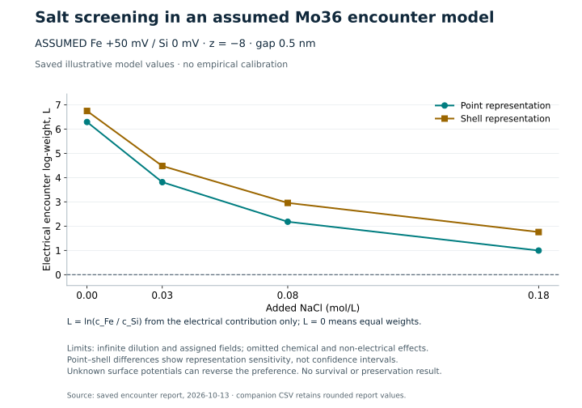
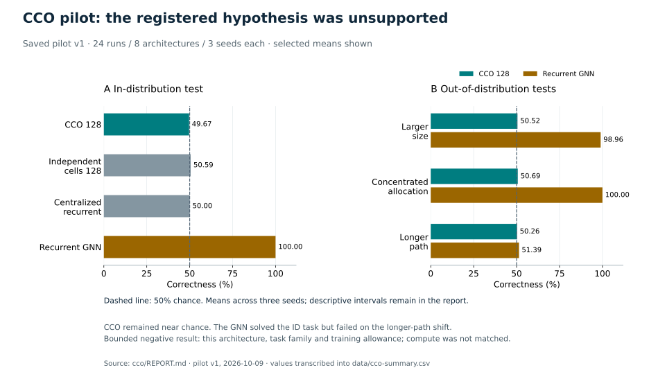

<p align="center">
  
</p>

<p align="center">
  <a href="docs/FINAL_RESULTS.md"></a>
  <a href="docs/EVIDENCE_GUIDE.md"></a>
  <a href="https://github.com/hadijannat/alternative-intelligence-lab/releases/tag/research-2026-10-13"></a>
</p>

<h1 align="center">Could another kind of matter become alive—and eventually think?</h1>

This repository publishes the final record of an exploratory research campaign: alternative chemistry, physical information processing, digital emergence, and collective computation. It brings literature evidence, saved numerical experiments, matched controls, negative results, and explicit limits into one inspectable archive.

**The central result: useful subsystems were identified and tested, but no autonomous non-carbon organism, integrated chemical lineage, or human-comparable emergent intelligence was demonstrated.** The latest Mo36 comparison cannot establish whether preformed FeIII or iron-free silica preserves the intact cluster better. The chemical investigation ended at a qualified-input dependency; its full goal remains unmet.

This is a research archive with computational results and literature analysis. It is not a report of new laboratory measurements or a peer-reviewed demonstration of alternative life.

**15 October continuation, updated 16 October:** [Ten laboratories](research/2026-10-15/README.md) add measured-chemistry models, RNA failure diagnostics, retention/inheritance assay simulations, a 1,000-record inorganic materials screen and the recursive compound investigation. The latest checkpoint has **24 candidate-role assessments and zero verified integrated complements**. The completed [saved-array sensitivity analysis](research/2026-10-15/recursive-compound-2026-10-15/parent-j-error-impact/analysis-v1/REPORT.md) measures fixed-density energy differences only; five original matrix comparisons still fail. The completed [stage-localization diagnostic](research/2026-10-15/recursive-compound-2026-10-15/parent-j-stage-localization/REPORT.md) retains an ordinary-repeat failure and a passing fixed-coefficient control, which does not repair the ordinary operator or qualify parent SCF. [Copper-phosphate role 24](research/2026-10-15/recursive-compound-2026-10-15/boundary/copper-phosphate-transport/DECISION.json) is assessed but unadmitted. [Hollow silicalite](research/2026-10-15/recursive-compound-2026-10-15/boundary/hollow-silicalite-followup/REPORT.md) refines the existing B1 boundary proposition, while [beta-VMo7](research/2026-10-15/recursive-compound-2026-10-15/identity/beta-vmo7-discriminator/REPORT.md) supplies a competing-species reference; neither provides a new target dataset or verified complement. Earlier numerical and chemical failures, the unexplained parent SIGTRAP and the tagged release remain preserved.

The [saved-metric replay](research/2026-10-15/recursive-compound-2026-10-15/parent-saved-metric-solve/REPORT.md) completed under explicit BLAS control. One repeated solve pair is bitwise identical, while tiny input changes produce much larger coefficient changes and the estimated condition number is about 2.50e13. The subsequent [ordinary-J diagnostic](research/2026-10-15/recursive-compound-2026-10-15/parent-explicit-blas-j/REPORT.md) completed two ordinary calls with zero SCFs or PCM builds, but repeatability **failed**: the maximum difference was 6.702407517877873e-10, with 630 entries exceeding the unchanged absolute 1e-10 limit. Both historical comparisons also failed. Configured BLAS1/PySCF4 getters do not measure executing worker teams. These results establish neither a repaired cause, parent SCF readiness nor chemical accuracy; the earlier [SIGBUS failure](research/2026-10-15/recursive-compound-2026-10-15/parent-metric-solve-diagnostic-v2/REPORT.md) remains unexplained. The [prospective accuracy draft](research/2026-10-15/recursive-compound-2026-10-15/explicit-blas-accuracy-qualification/PROTOCOL_DRAFT.md) remains unimplemented and unfrozen, with its prerequisite failed and the reserved holdout unused.

[Wetting constraints](research/2026-10-15/recursive-compound-2026-10-15/boundary/hollow-silicalite-followup/wetting-constraint/REPORT.md), [sample-processing constraints](research/2026-10-15/recursive-compound-2026-10-15/identity/concentration-speciation-followup/REPORT.md) and the new [measurement-integrity follow-up](research/2026-10-15/recursive-compound-2026-10-15/identity/measurement-integrity-followup/REPORT.md) refine prospective assays without demonstrating target retention or identity. The latter supplies analytical-method and isotope-exchange controls, with no raw quantitative dataset, new role or complement admission. Another [original-source access attempt](research/2026-10-15/recursive-compound-2026-10-15/identity/competing-mov-speciation/ACCESS_FOLLOWUP_2026-10-16.md) recovered no numerical data. Earlier failures and the 28-row aqueous nanofiltration audit remain preserved. The 3.08 GB matrix remains local; its hash and inspection results are published under the explicit [size exclusion](docs/ARCHIVE_POLICY.md).

<p align="center">
  <a href="#the-results-at-a-glance">Results</a> ·
  <a href="docs/FINAL_RESULTS.md">Scientific report</a> ·
  <a href="#read-at-your-own-depth">Reading paths</a> ·
  <a href="#download-the-research-record">Data &amp; archives</a> ·
  <a href="#selected-primary-sources">Sources</a>
</p>

The [serial native RHS prefix diagnostic](research/2026-10-15/recursive-compound-2026-10-15/parent-serial-rhs-diagnostic/REPORT.md) **completed** two pass-1 contractions and two stop sentinels with one factorization, zero solves, zero completed J calls, zero SCFs and zero PCM builds. Its two finite float64 (19612, 1) RHS arrays are **bitwise identical**. This passes only the serial-prefix repeat criterion; [Independent terminal review](research/2026-10-15/recursive-compound-2026-10-15/parent-serial-rhs-diagnostic/INDEPENDENT_REVIEW.md) is CLEAR for publication of this scoped result. The original full-J repeatability failure remains 6.702407517877873e-10 at 630 entries above the unchanged absolute 1e-10/relative-zero limit, and the reserved holdout remains unused. The registered H-only relaxation and stability comparison also needs derivative and response support that the current ground-state wrapper rejects; numerical repeatability cannot execute that chemical comparison.

The reviewed [tantalum-coated alumina comparator](research/2026-10-15/recursive-compound-2026-10-15/boundary/tantalum-coated-alumina-followup/REPORT.md) refines existing B2 with three published observations, retaining acid loss and unmeasured aqueous target selectivity. The reviewed [vanadate NMR control](research/2026-10-15/recursive-compound-2026-10-15/identity/vanadate-nmr-control/REPORT.md) retains eight source-table rows and all three printed models without fitting target parameters or testing V incorporation. Their [shared review](research/2026-10-15/recursive-compound-2026-10-15/review/serial-continuation-chemistry.md) and ROOT_REVIEW records accept source constraints only. The [Ir/Ta reacquisition](research/2026-10-15/recursive-compound-2026-10-15/renewal/ir-ta-reservoir-reacquisition/REPORT.md) remains a duplicate source. These results add no role or admission: 24 assessed roles, zero verified integrated complements and all twelve integrated requirements unmet.

The [derivative/stability audit](research/2026-10-15/recursive-compound-2026-10-15/derivative-route-audit/REPORT.md) identified additional dependencies for the registered H-only comparison: incompatible derivative dispatch if guards are bypassed, missing solvent-response state, and an inspected external-stability Fock path that omits the tagged solvent contribution. Its 84.16-GiB full-block derivative estimate is allocation arithmetic, not measured memory or an executed failure. The original [C-PCM response attempt](research/2026-10-15/recursive-compound-2026-10-15/cpcm-response-probe/FAILURE_REPORT.md) failed at its startup pin check before constructing a molecule. That failure and its frozen preparation remain preserved.

The separately reviewed [corrected response attempt](research/2026-10-15/recursive-compound-2026-10-15/cpcm-response-probe-v2/REPORT.md) completed all **60 checks**, retaining **93 finite arrays/scalars**, in 7.01 seconds with 281,526,272 bytes sampled maximum RSS. It achieved **PASS_RESPONSE_COMPONENT_ONLY** on the retrospective hypothetical MoO4 fixture: maximum stock-response discrepancy 3.1225e-17 and finite-difference discrepancy 1.3874e-12, within unchanged absolute tolerances. Independent saved-array review supports this fixed-geometry solvent component. Full Fock response, orbital stability, nuclear derivatives, parent accuracy and target chemistry remain unqualified. No SCF or holdout ran. The [full-Fock response design](research/2026-10-15/recursive-compound-2026-10-15/full-fock-response-next-step/PLAN.md) remains an unimplemented, unapproved draft.

The [alternate Moussawi thesis route](research/2026-10-15/recursive-compound-2026-10-15/identity/moussawi-alternate-deposit-followup/REPORT.md) records an accessible author-associated figure page and investigator-reported access failures, with no saved PDF, raw response, substitution chapter, CIF or occupancy data. A [journal/deposition follow-up](research/2026-10-15/recursive-compound-2026-10-15/identity/moussawi-alternate-deposit-followup/JOURNAL_ROUTE_FOLLOWUP.md) found only duplicate sources and no new structural constraint. Exact W/V target identity remains unresolved. Available work is simulation and literature only, as confirmed by the user. The checkpoint adds no role or admission: 24 assessed roles, zero verified integrated complements and all twelve requirements unmet; the full-J failure remains unchanged.

The historical [response preparation report](research/2026-10-15/recursive-compound-2026-10-15/cpcm-response-probe/REPORT.md) retains its seven mock passes and then-unrun status. The terminal reports above supersede that historical execution status.

## The results at a glance

| Research track | What the saved record establishes | What remains unresolved |
| :--- | :--- | :--- |
| **Chemical evidence map** | **329 preparations across 58 source-architecture groups**, registry v2.44 | These include organic controls, hybrids and engineered devices; they are not 58 demonstrated forms of life |
| **Mo36 / FeIII / silica** | **480** conditional electrostatic encounter cases; the preference reverses across allowed assigned fields | Intact-cluster survival, chemical adsorption, precipitation and clogging |
| **Quantum-chemistry runtime** | H2 and water electronic calculations converged; the final two-process repeat difference was zero | A qualified full Mo36 geometry and validated target binding or breakdown energies |
| **Collective Cognitive Organism pilot** | **24 trained runs**; CCO128 achieved **49.67%** ID correctness, recurrent GNN **100%** | The registered CCO advantage was unsupported; GNN longer-path OOD correctness fell to **51.39%** |
| **Digital learning and copying** | Supplied programs showed causal memory effects and three descendant transfers in two prepared histories | Natural origin, robust open-ended adaptation and physical chemical implementation |
| **Separate noncarbon-route programme** | **465 Stage A–C runs** with conditional model-level mechanisms | REQ-18 was not met; physical cognition gate G4 remained unresolved |

Counts are taken from the saved, dated reports and canonical registry. Source reviews, numerical calculations and experimental literature observations are different evidence classes and are never pooled into a single success rate. See the [final report](docs/FINAL_RESULTS.md) and [evidence guide](docs/EVIDENCE_GUIDE.md).

## From chemistry to cognition: the missing transitions


**All seven gates remain unresolved for the proposed integrated alternative system.** The arrows describe requirements, not an observed evolutionary sequence. A seed-dependent reaction, a durable material, or an engineered memory device can establish a subsystem without establishing a living lineage. Carbon life provides a reference; its known capabilities do not transfer to a proposed alternative by analogy.

## Mo36: a promising assembly lead with a decisive measurement gap

The strongest scoped inorganic assembly lead was acidic-water **[Mo₃₆O₁₁₂(H₂O)₁₆]⁸⁻**, with Mo(VI), externally supplied molybdate and acid. Published seed-dependent assembly supports molecular autocatalysis under particular conditions. It does not establish inherited functional variants or autonomous reproduction. [Assembly kinetics](https://pmc.ncbi.nlm.nih.gov/articles/PMC7245103/), [templating intermediate](https://pubmed.ncbi.nlm.nih.gov/20044572/).

The final comparison used a narrower physical model: planar Poisson–Boltzmann electrostatics with **assigned** interface potentials, charges and geometry. Surface-complexation theory motivates this electrical contribution, while distinguishing it from chemical reactions at the interface. [3]



For the illustrated assumptions, added salt reduces the electrical preference for encountering the FeIII-bearing interface. Across the full admitted sensitivity grid, however, the natural-log encounter ratio spans **−11.661949 to +15.174195**, and changing the assumed fields can reverse the ranking.

**Neither support is a demonstrated preservation winner.** Greater encounter frequency could improve retention or increase destructive contact. Capturing total molybdenum cannot by itself establish that intact Mo36 survived.

<details>
<summary><strong>Technical model, assumptions and numerical checks</strong></summary>

For a monovalent bath, the dimensionless diffuse-layer field was

```text
u(x) = 4 atanh[tanh(psi_d / (4 V_T)) exp(−kappa x)]
L = ln(c_Fe / c_Si) = −z [mean(u_Fe) − mean(u_Si)]
```

Here `exp(L)` is an electrical-only infinite-dilution statistical weight. It is not a measured adsorption constant or probability of intact recovery.

Distances are measured from the assigned diffuse-boundary plane, the plane of `psi_d`. Both charge representations share one centre distance `d = a + gap`, where `a` is the padded shell radius and the gap runs from that plane to the nearest point of the shell. The point model uses `u(d)`; the shell model uses the surface average `(1/2) ∫[−1,1] u(d + a·mu) dmu`. With these conventions, the formula and the values stored in the full output (the shell radius, the thermal voltage and the screening constant `kappa` of each bath) reproduce the saved rows; placing the point charge at `x = gap` instead gives 12.007 rather than 6.290 for the illustrated point value at zero added NaCl (FeIII +50 mV, silica 0 mV, 0.5 nm gap). The conventions are those of the archived `encounter/protocol.md` and `encounter/model.py` (release asset `research-0003.tar.gz`).

The illustrated CSV uses T = 297.45 K, nominal ideal HCl pH 1.7, assumed relative permittivity 78.5, FeIII +50 mV, silica 0 mV, charge −8, and a 0.5 nm gap. Point and uniformly charged-shell representations are compared. The shell radius includes an assumed 0.300 nm padding around the Mo skeletal radius.

The 480 main cases varied bath, two interface fields, distance and charge representation. Equal-field, sign, swap, far-field, weak-field and quadrature controls passed. Maximum 64/128-point shell quadrature discrepancy was **4.26 × 10−14** in L. Such checks establish numerical consistency, not empirical calibration.

In all 480 rows the sign of L equals the sign of the assigned Fe-minus-silica potential, so every reversal is an input assumption: it requires silica to be assigned a higher potential than the FeIII interface. Literature charge-reversal points added in post-publication review [9, 10] are discussed, with their limits, in the [final report](docs/FINAL_RESULTS.md#conditional-electrical-result).

The model omits surface reaction pathways, dissolution, real Mo speciation, nucleation, transport and clogging. It is also a test-charge calculation: the assigned interface fields do not respond to the −8 solute, and dielectric boundaries and solute-induced field distortion are neglected. Each assigned potential is held fixed across the salt grid as a deliberate sensitivity choice; real surfaces may regulate charge. The archived protocol calls the test-particle approximation “especially conditional” for the highly charged Mo36, and treats the point/shell comparison as representation sensitivity, not a confidence interval. Only 36 qualified Mo coordinates were available; incomplete/anomalous O/H information prevented justified full-cluster DFT. [4]

The [complete frozen 480-case result](data/mo36-encounter-full.json), [illustrated data](data/mo36-encounter-illustrative.csv), and [scientific limits](docs/FINAL_RESULTS.md#mo36-interface-comparison) are available separately.

</details>

## A useful negative result: collective cells did not win this task

The registered CCO pilot trained eight architectures with three seeds each. Its 128-cell model remained near chance on the held-out graph-reachability task and did not outperform its primary learned baselines. A conventional recurrent GNN solved the in-distribution task, but its performance deteriorated on unseen longer paths.

The ID test has 512 queries in 256 graph pairs, and each OOD set has 384 queries in 192 pairs. Every graph supplies one positive and one negative query, so chance is exactly 50%. Each run received 192 optimizer updates, with no hyperparameter search. The GNN's 51.39% on longer paths is a one-sided failure, not chance-like behavior: a post-publication recount of the archived predictions, pooled over the three seeds, found all 576 negative predictions correct (192 queries per seed) and only 16 of the 576 positive predictions correct, all 16 from one seed.



This is a bounded negative result for the architecture, benchmark and training allowance. It does not refute collective intelligence generally. Compute, routing, recurrent-state capacity and parameters differed between some baselines (the GNN has 52,033 parameters against 37,706 for CCO128, but about one-fifth of the estimated forward compute of CCO128); compute-matched superiority was not tested. The complete pilot report, checkpoints, predictions and analysis are in the [CCO release archive](https://github.com/hadijannat/alternative-intelligence-lab/releases/tag/research-2026-10-13).

## What the gold and SAPO-34 papers actually contributed

| Paper | Supported contribution | Evidence boundary |
| :--- | :--- | :--- |
| **Duan et al., gold-autocatalyzed multielement nanoparticles** [5] | Feed-controlled material synthesis and separately powered catalytic testing | The inspected main text did not establish parent-linked functional heredity; supplementary information was not fully inspected |
| **Akhgar et al., SAPO-34 seed study** [6] | Seed/recipe-dependent product properties and MTO catalyst performance | A seed-dependent materials effect does not by itself establish a replicating, evolving functional lineage |

These are valuable materials results. Their contribution to the alternative-life question depends on additional tests of identity, transmission, new-product function and resource closure.

## Read at your own depth

| Reader | Start here | Then explore |
| :--- | :--- | :--- |
| **Curious reader** | The result table and chemistry-to-cognition diagram | [Plain-language evidence guide](docs/EVIDENCE_GUIDE.md) |
| **Student or educator** | [Final findings and glossary](docs/FINAL_RESULTS.md) | Compare a subsystem result with the evidence needed for heredity |
| **Chemist or physicist** | The Mo36 technical section and full output | Registry, interface protocols and archived sensitivity studies |
| **ML or simulation researcher** | The CCO negative result and digital controls | Frozen predictions, model code, configurations and historical reports |
| **Reviewer or reproducer** | [Provenance and reproducibility](docs/REPRODUCIBILITY.md) | Manifests, checksums, archive policy and exclusions |

## Download the research record

**Snapshot:** 13 October 2026. [Download the tagged research release](https://github.com/hadijannat/alternative-intelligence-lab/releases/tag/research-2026-10-13).

The repository holds the synthesis, figures and key machine-readable results. Release assets preserve the much larger authored scientific record: reports, numerical outputs, configurations, model code, negative findings and historical studies. Archives are split where needed; membership and checksums are indexed.

The release preserves **23,926 eligible files in 14 archive parts**: 3.04 GB of compressed archives (the 14 archive parts, without the manifest and index assets) and 6.91 GB of reconstructed files, in decimal gigabytes (10⁹ bytes). Counts include historical versions and repeated provenance copies. Select a study group with the [extraction helper](docs/ARCHIVE_POLICY.md#invocation) when you need a smaller subset.

- [Complete archive catalogue](data/archive-catalogue.json) — assets, sizes, checksums and coverage.
- [Searchable research-file index](data/research-index.csv) — result/report paths and asset membership.
- [Canonical candidate summary](data/candidates.csv) — all 329 preparation records, with source-architecture families and evidence status.
- [Initial claim-level evidence ledger](data/initial-evidence-ledger.json) — 34 claims, conditions and limitations from the earlier bounded review.
- [Publication policy and exclusions](docs/ARCHIVE_POLICY.md) — third-party acquisition payloads, private tool records, dependencies and path sanitization.

Historical reports retain their original dates and conclusions. Some describe an investigation as “active”; the [current status overlay](docs/FINAL_RESULTS.md) supersedes those statements. Publication does not rerun or independently replicate the original scientific experiments. Corrections made after the tagged snapshot are listed in [docs/CORRECTIONS.md](docs/CORRECTIONS.md).

## Inspect and reproduce

```sh
git clone https://github.com/hadijannat/alternative-intelligence-lab.git
cd alternative-intelligence-lab
python3 tools/verify_publication.py
```

The verifier checks this publication's links, key data counts and archive metadata. It does not execute scientific models. [Reproduction instructions](docs/REPRODUCIBILITY.md) explain how to recover the larger archives, interpret transformed hashes and locate each original environment and protocol.

To rebuild the displayed charts from the saved summary CSVs, install the documented plotting dependency and run `python3 tools/render_figures.py`. This redraws existing results; it does not retrain models or simulate new chemistry.

## What would change the conclusion?

For the FeIII/silica comparison, a consequential next dataset would measure initial and timed **intact Mo36** in both liquid and recoverable solid fractions, with matched arms, a no-support baseline, recovery calibration, uncertainty and material closure. Endpoint recovery and continuous molecular survival require different interpretations.

For the larger goal, those results would still need to connect to driven maintenance, functional inheritance, adaptive evolution, physical cognition and justified multidimensional capability tests in the same system. A new model would require qualified inputs and independent error/convergence controls before it could settle those transitions.

## Selected primary sources

1. [Mo-oxide molecular autocatalysis and seed-dependent assembly (2020)](https://pmc.ncbi.nlm.nih.gov/articles/PMC7245103/). See initial-ledger claims N10–N11 for conditions and phenomenological-rate limits.
2. [Mo36-centred templating intermediate in molybdenum-oxide assembly (2010)](https://pubmed.ncbi.nlm.nih.gov/20044572/). Assembly templating is the scoped claim.
3. [Li & Zarzycki (2022), *A computational pipeline to generate a synthetic dataset of metal ion sorption to oxides for AI/ML exploration*](https://doi.org/10.3389/fnuen.2022.977743). Theory context; synthetic data do not calibrate our two supports.
4. [Junkers et al. (2025), Mo36 coordinate-source preprint](https://doi.org/10.26434/chemrxiv-2025-tjp5z). The local coordinate qualification and its limitations are retained in the archive.
5. [Duan et al. (2025), *Gold-Autocatalyzed Synthesis of Multi-Element Nanoparticles*](https://doi.org/10.1002/adma.202501110).
6. [Akhgar, Towfighi & Hamidzadeh (2020), *Investigation of synthesis time and type of seed along with reduction of template consumption in the preparation of SAPO-34 catalyst and its performance in the MTO reaction*](https://doi.org/10.1039/D0RA05673A).
7. [Engineered XNA genetic information storage and recovery (2012)](https://pmc.ncbi.nlm.nih.gov/articles/PMC3362463/). Carbon-containing polymers and supplied enzymes.
8. [XNA catalytic function and FANA fragment ligation (2014/2015)](https://pmc.ncbi.nlm.nih.gov/articles/PMC4336857/). Catalysis and copying machinery do not establish autonomous organisms.
9. [Kosmulski (1998), *Positive Electrokinetic Charge of Silica in the Presence of Chlorides*](https://doi.org/10.1006/jcis.1998.5859). Added in post-publication review; abstract-level reading only. Context for the assigned silica potential, not a calibration.
10. [Schwertmann & Fechter (1982), *The point of zero charge of natural and synthetic ferrihydrites and its relation to adsorbed silicate*](https://www.cambridge.org/core/journals/clay-minerals/article/point-of-zero-charge-of-natural-and-synthetic-ferrihydrites-and-its-relation-to-adsorbed-silicate/6731E772B614A298097A94D944C9E24F). Added in post-publication review; abstract-level reading only. Not a calibration of the FeIII support.

Links identify the primary literature behind specific claims. An accessible citation is distinct from a newly verified full text; the archived ledgers record which originals, methods and supplements were actually inspected.

## Cite, contribute and reuse

Use [CITATION.cff](CITATION.cff) to cite this dated research archive; it has no assigned DOI. Maintainer: [MHadi Jannatabaadi](https://github.com/hadijannat). Research and publication preparation used AI assistance; scientific claims remain limited to the cited evidence and saved calculations. See [contribution requirements](CONTRIBUTING.md).

Original code is provided under [MIT](LICENSE). Original synthesis, figures and project-generated data are provided under [CC BY 4.0](LICENSE-DATA.md). Third-party works retain their own rights and licenses. Historical embedded notices take precedence for third-party components.
