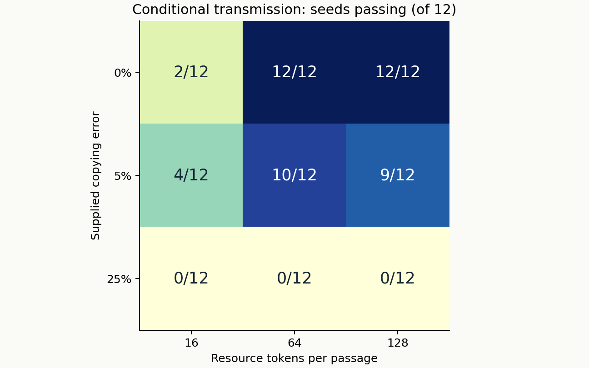
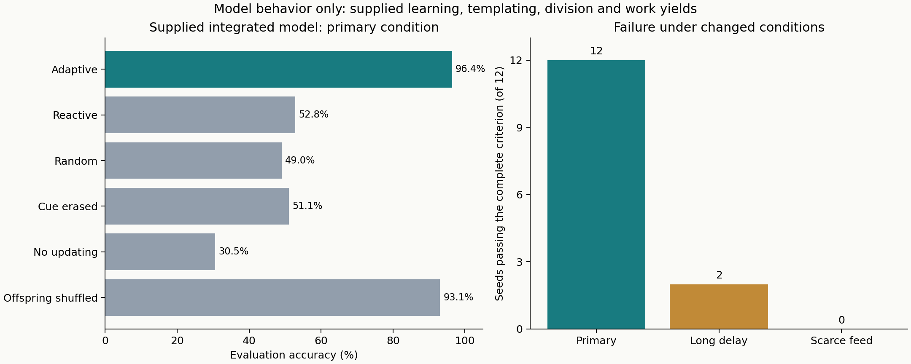
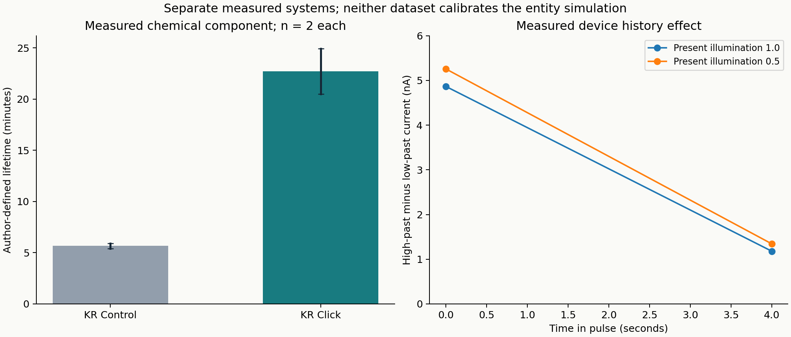

# An alternative route: a fueled compartment that preserves and uses functional state

15 October 2026. **The most defensible route from this investigation is an engineered, fuel-dependent protocell: a compartment whose useful internal chemistry helps maintain the compartment, whose descendants retain that chemistry, and whose internal state can improve resource acquisition.** This is a research recommendation. No physical living or intelligent entity has been created.

Three computational laboratories and a public-data analysis laboratory are implemented and executed here. They establish conditional model behavior, expose failure conditions, and specify what must be measured next. The code, frozen protocols, raw trajectories, earlier defective versions and verification evidence are retained.

## What changes relative to the repository

The reviewed public repository and local publication checkout both resolve to [`73d0d656a1f0f51ebbb59ba4c9cc4c7f8ea480d4`](https://github.com/hadijannat/alternative-intelligence-lab/tree/73d0d656a1f0f51ebbb59ba4c9cc4c7f8ea480d4). Its [final report](https://github.com/hadijannat/alternative-intelligence-lab/blob/73d0d656a1f0f51ebbb59ba4c9cc4c7f8ea480d4/docs/FINAL_RESULTS.md) leaves all integrated G0-G6 gates unresolved. Its Mo36 calculation cannot establish intact-cluster survival, its CCO pilot did not establish the registered advantage, and supplied digital programs do not establish chemical implementation or natural origin.

The broader local archive also contains a chemical-association reconstruction in which all controllers collapsed, exact serial-transfer observability calculations, and supplied digital learning/copying demonstrations. Repeating isolated memory or threshold calculations would add little. The new experiment instead makes maintenance, learned functional composition, resource access and descendant partition share one finite resource account.

The new suite follows existing patterns for finite accounting, founder/new-material separation, independent environmental random streams, paired controls and explicit failure verdicts. The integrated model directly imports the new maintenance core and conservative partition function. No old experimental rates are transferred into it. The old publication and research results remain unchanged. Global scientific novelty has not been established.

## Which material route to pursue

| Route | Reason to consider it | Present decision |
|---|---|---|
| Fueled droplets with a retained autocatalyst | Experimentally observed reciprocal effects connect a useful internal process to compartment persistence | Lead integration candidate; establish functional transmission through offspring next |
| RNA networks in coacervates or vesicles | Replication, compartment retention and serial propagation have experimental precedents | Strong comparator; do not assume shared conditions with the lead droplet chemistry |
| XNA-based heredity | Alternative genetic polymers can carry information and undergo selection with engineered machinery | Later information-carrier option; autonomous synthesis and maintenance are missing |
| Inorganic clusters or material memories | Assembly and history-dependent response offer component mechanisms | Keep as component branches; compatibility, renewal and functional inheritance remain open |
| Electronics-assisted hybrid | Sensors/controller could make adaptation experimentally inspectable | Valid engineering comparator if external computation and power remain explicit |

The lead is carbon-containing. The user's request permits any chemistry, and this route connects more experimentally observed interfaces than the purely inorganic options inspected here. It is an alternative architecture of synthetic life, not a claim that carbon has been replaced.

[Soria-Carrera et al.](https://doi.org/10.1016/j.chempr.2025.102816) report reciprocal effects between an autocatalyst and fueled droplets, while leaving division with replicator inheritance to future work. [Wenisch et al.](https://doi.org/10.1016/j.chempr.2025.102578) separately report offspring formation, molecular transmission and refueling rescue. Their combination is a hypothesis, not an accomplished integrated experiment. RNA [coacervate networks](https://doi.org/10.1038/s42004-023-00887-5) and [serial vesicle propagation](https://doi.org/10.1038/s41467-023-36940-z) provide useful comparators with their own restrictions. The recent [compartmentalized bistability study](https://pubmed.ncbi.nlm.nih.gov/42766742/) is computational motivation, with supplied division and environmental coupling.

## Laboratory 1: finite-resource maintenance

[Protocol](maintenance/PROTOCOL.md), [code](maintenance/model.py), [results](maintenance/results-v1/report.md).

The phenomenological core explicitly tracks activated substrate, structure, retained waste, stored work, expenditure, dissipation and founder/new structure. Finite substrate conversion can finance renewal and work. The caller debits a finite external reservoir. These are dimensionless material tokens and assigned work yields; conservation is not a thermodynamic or kinetic calibration.

Forty-eight trajectories cover 12 shared feed histories and normal, no-feed, no-renewal and increased-leakage conditions. **All 12 histories pass the predeclared conditional maintenance criterion.** Normal final structure is 4.081-4.119 tokens, versus 0.114 without feed, 0.091 without renewal and 1.445-1.480 under greater leakage. The maximum ledger residual is 1.56e-13. Halving the integration step changes endpoint structure by at most approximately 0.30% in the declared constant-feed check.

This establishes internal numerical accounting and behavior of an assigned renewal law. It does not identify a chemical reaction that realizes that law.

## Laboratory 2: compositional functional transmission

[Protocol](heredity/PROTOCOL.md), [code](heredity/lab.py), [results](heredity/results-v1/REPORT.md).

Twenty-four tracked compartments undergo 16 passages with finite paid synthesis, two supplied catalytic types, degradation, conservative partition and separate founder/new tags. Faithful transmission is compared with exchanged parent composition, neutral synthesis and no synthesis. Active controls match founder/new counts exactly. An ideal selective founder purge tests whether new material, rather than founder carryover, accounts for activity; the purge is a simulator intervention, not a demonstrated separation procedure.

The frozen grid contains three resource budgets, three copying-error probabilities, four arms and 12 seeds: **432 arm trajectories and 165,888 compartment/passage records**. Only two of nine conditions meet the every-seed criterion: zero copying error with budgets 64 and 128. At 5% error, 4/12, 10/12 and 9/12 seeds pass at budgets 16, 64 and 128 respectively. At 25% error none pass. More supplied resource therefore does not automatically resolve loss of compositional information.



All material balances are exact; finite synthesis and reporter-fuel checks pass. New-material activity is known because the simulator tracks it exactly. Physical catalytic specificity, copying and experimentally identifiable new functional descendants remain unverified. There is no population selection in this laboratory.

## Laboratory 3: one integrated adaptive lineage

[Protocol](integrated/PROTOCOL.md), [code](integrated/lab.py), [accepted numerical results](integrated/results-v1.2/summary.json), [correction history](integrated/AMENDMENT-v1.1.md).

One supplied compartment receives a cue, retains it through an assigned noisy memory channel, chooses a resource site, and changes its compositional mapping from observed resource yield. The mapping reverses twice. Sensing, action, switching and division consume work. Renewal produces actual structure; two integer carrier populations label that structure. Once sufficiently large, the compartment pays for division and partitions its actual carriers. One daughter continues; its sister's inventories remain in an external accounting ledger. No independently generated child is inserted.

The feedback rule, copying law, cue memory and division threshold are supplied. The model has no molecular reaction network implementing them, no spatial membrane, no unstructured origin and no evolving population. Its inherited variable is learned functional composition. Calling the simulated agent alive or generally intelligent would exceed this evidence.

There are **360 trajectories: 12 seeds x 10 arms x 3 scenarios**, each with 288 episodes. Evaluation excludes the first 32 episodes after each mapping change; these learning periods still consume resources. Missed episodes after death count as wrong. All raw observations are retained in [trajectories.csv](integrated/results-v1.2/trajectories.csv).

| Condition | Adaptive accuracy | Reactive accuracy | Random accuracy | Mean descendant partitions | Seeds passing complete integration criterion |
|---|---:|---:|---:|---:|---:|
| Primary | 96.40% | 52.78% | 49.05% | 20.00 | 12/12 |
| Long information delay | 55.69% | 52.78% | 49.05% | 10.92 | 2/12 |
| Scarce feed | 96.40% | 52.78% | 49.05% | 0.00 | 0/12 |



The primary criterion requires survival, at least three partitions, founder fraction below 5%, and at least ten percentage points of accuracy advantage over both baselines **in every seed**. Adaptive primary lineages complete 19-21 partitions. The primary mean of paired advantages over each seed's stronger baseline is 37.93 percentage points; the descriptive seed-bootstrap 95% interval is 32.38-44.27 points. It quantifies variation over these simulations, not confidence in physical realization.

Targeted cue erasure reduces primary accuracy to 51.09%; disabling updates gives 30.51%. Irrelevant erasure reproduces adaptive outputs exactly. Both no-feed and no-renewal controls lose the tracked entity in all 12 primary histories. Maximum global material/work residual across the campaign is 6.82e-12, below the declared 1e-8 tolerance.

Two limitations directly affect interpretation. First, random and reactive primary agents also survive and divide: the primary environment does not make learning necessary for survival. Learning increases resource acquisition and descendant count under the supplied rules. Second, randomizing offspring composition leaves 93.10% accuracy, only 3.30 percentage points below adaptive, because continued learning can recover. This does not establish that inherited mapping is indispensable. In scarce feed, learning remains accurate but no lineage divides, separating task competence from reproductive viability.

The long-delay scenario isolates information retention: it changes the memory channel without lengthening maintenance time. It cannot predict the survival cost of waiting longer in a physical bath. Finite-horizon survival is not indefinite autonomy.

Independent review found two defects in initial v1: hidden correctness could reach learning with exhausted resource, and label bookkeeping could imply replacement without material renewal. Both were corrected with regression tests; raw v1 and its source snapshot remain available. Final v1.2 also rejects invalid empty evaluation horizons. Parameters and acceptance criteria were unchanged. v1.1 and v1.2 numerical files match exactly; these are corrections/replays, not extra independent trials.

## Laboratory 4: measured public component data

[Research report](research/REPORT.md), [ten-study source ledger](research/sources.json), [download provenance](research/datasets_manifest.json), [analysis code](research/analyze_data.py).

The review acquired 407,843 bytes of author-deposited chemical measurements and a physical-memory dataset. All retained files have source URLs, acquisition UTC, SHA256, license notes and units. Chemical files are pinned to author-repository commit `5e39536facd68c2a133454b6a31390d53f19ad30`; physical files are associated with [Zenodo DOI 10.5281/zenodo.21453837](https://zenodo.org/records/21453837). No measured parameter calibrates the entity simulator.

The chemical lifetime subset contains only two observations per condition. Its KR Click mean is **22.7167 minutes**, versus **5.6667 minutes** for matched KR Control: a descriptive ratio of **4.0088**. The chemical selectivity-error means are 0.216290 in seeded droplets and 0.433271 in the corresponding seeded no-droplet group. This wrong-product measure is not a genetic mutation probability. The 494 turbidity rows and operational half-peak summaries are also retained, with their unequal windows and inferred series boundaries documented.

The separate device archive contains 19,744 corrected-current rows over 400 pulses. At four seconds, the high-versus-low previous-input contrast retains 24.26% or 25.59% of its initial value for two matched present-input groups. This supports a material history effect under imposed measurement conditions; it does not demonstrate autonomous adaptation. Its associated source is a preprint and its baseline correction was not independently reconstructed.



Lifetime bars show means with observed ranges, not confidence intervals. Lines in the memory panel connect the two summarized times as visual guides, not fitted decay trajectories. These measured systems use different chemistry and operating conditions. Combining their timescales does not establish an integrated material system.

## Physical laboratory programme and decision gates

These are proposed experiments, not executed physical work. A viable fed entity can rely on environmental energy and nutrients; it must renew the components needed for its own continued function. The central issue is how much of that renewal and control the experimenter supplies.

| Laboratory | Discriminating observation | Controls and decision |
|---|---|---|
| Common-condition compatibility | Measure catalyst function, compartment lifetime, leakage and fuel turnover in the same bath | Compare each component alone and combined. Stop integration if the combination destroys its required component; retain measured missingness |
| Renewal and damage recovery | Newly supplied material restores useful catalytic and boundary function after depletion/damage | Equal feed, inactive catalyst, no fuel, passive-retention and founder-carryover controls. Require function attributable to newly produced material |
| Functional offspring transmission | Parent-linked variants cause reproducible descendant differences after founder material becomes insufficient | Common environment; fresh-initiation, shuffled-parent and inactive-product controls; track identity, amount and function independently over multiple transfers |
| Adaptive resource access | Past cues change future uptake/protection in a beneficial, reversible, resource-paid way | Fixed, random, direct-response, targeted-erasure and irrelevant-erasure controls; unseen sequences and cue reversal; separately measure hardware/external-controller contribution |
| Lineage selection | Heritable functional differences predict offspring success and change population composition | Neutral-selection and parent-shuffle controls; include negative lineages, resource costs and repeated environmental changes |

Before an inheritance claim, determine an actual net reproduction factor for newly functional material under common conditions. An amplification x retention x descendant-transfer product above one is a necessary screening condition, not sufficient evidence for life or evolution. Measure its uncertainty and chemical specificity rather than borrowing numbers across publications.

The immediate physical priority is **useful catalyst regeneration and functional transmission through offspring in one compatible fueled compartment**. Only then does adding internal adaptive regulation address a remaining demonstrated subsystem gap. A hybrid electronic controller can serve as an upper benchmark while the material implementation remains an explicit open requirement.

## Evidence verdict and reproduction

| Claim | Verdict from this work |
|---|---|
| Reproducible bounded computational suite | Supported: 33 tests and ten replay comparisons pass |
| Conditional maintenance plus narrow adaptation and descendant partition | Supported under the primary supplied model; fails the full criterion in both stress scenarios |
| Robust functional transmission | Supported only in two frozen zero-error standalone grid cells; conditional copying law supplied |
| Compatible integrated physical chemistry | Insufficient evidence |
| Autonomous living entity, natural emergence or Darwinian evolution | Not demonstrated |
| General or human-comparable intelligence | Not demonstrated |

Run the full offline verification from this directory, choosing an unused output directory:

```sh
/USER_HOME/.pyenv/versions/3.12.3/bin/python3 run_suite.py --output verification-new
```

The runner executes each test module in its own process, reruns all laboratories and compares retained numerical outputs. This separation is required because standalone test modules use local names such as `lab`; one combined pytest collection is not supported. One installed Schemathesis/jsonschema plugin emits a pre-existing deprecation warning. No test was skipped or weakened.

The tested environment is Python 3.12.3, NumPy 2.4.1, matplotlib 3.10.8 and pytest 8.4.2. No new package, paid service or external write was required. Research analysis uses the standard library. [checks.md](checks.md), [review.md](review.md) and [verification receipt](verification-v1/verification.json) contain the acceptance evidence. A deterministic replay establishes repeatability of the computation, not an independent physical replication.
