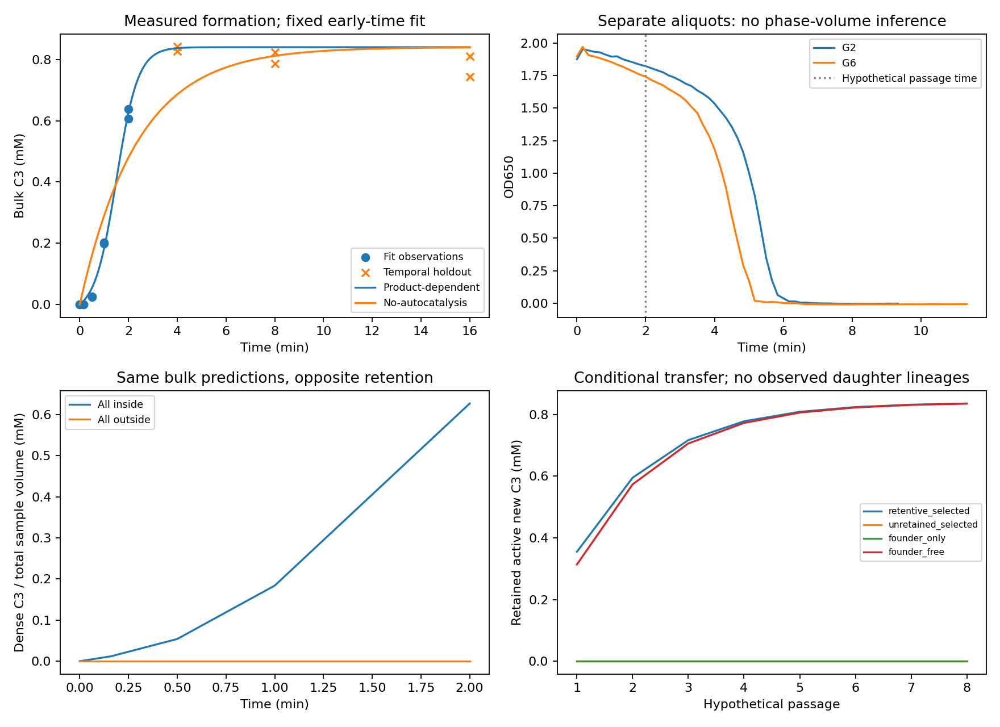
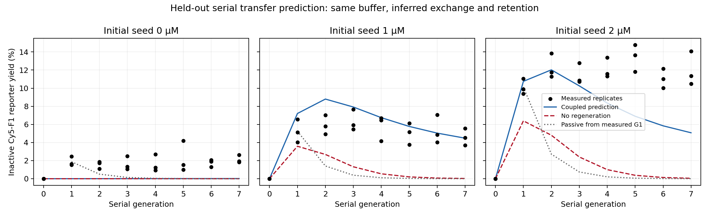

# Regeneration, retention and inheritance under measured chemistry

15 October 2026. Two measured-chemistry simulation laboratories are implemented and executed. **The droplet data constrain bulk production but leave active retention and functional inheritance unidentified. The RNA model fails its held-out prediction screen. Neither result establishes all three processes operating together as an inherited compartment function.**

## What this continuation tests

The reviewed repository at commit [`73d0d656a1f0f51ebbb59ba4c9cc4c7f8ea480d4`](https://github.com/hadijannat/alternative-intelligence-lab/tree/73d0d656a1f0f51ebbb59ba4c9cc4c7f8ea480d4) leaves the integrated chemistry, maintenance and heredity gates unresolved. Its conditional electrical, digital and cognitive calculations cannot supply missing chemical rates. The preceding [four-laboratory suite](../alternative-entity-lab-2026-10-15/REPORT.md) explored supplied maintenance and inheritance laws. This continuation asks which of those interfaces can actually be constrained by primary chemical observations.

Two executable laboratories use separate published systems. They fit available observations, carry material and founder/new-product accounts through hypothetical or source-matched transfers, compare controls, and expose missing lineage information. Neither laboratory simulates intelligence, spontaneous origins or an autonomous organism.

## Data and compatibility

| Source | Retained numerical evidence | Use and restriction |
|---|---|---|
| [Soria-Carrera et al., Chem](https://doi.org/10.1016/j.chempr.2025.102816), [author data at pinned commit](https://github.com/hsoria/Primitive-Genotype-Phenotype-coupling/tree/5e39536facd68c2a133454b6a31390d53f19ad30) | 7,104 normalized rows across kinetics, turbidity, lifetime, partition, refueling and other assays; 81 retained author files plus SI | Fit C3 kinetics and separately inspect turbidity from the same nominal formulation. Rows are observations across different assays, not 7,104 independent experiments. |
| [Salibi et al., Nature Communications](https://doi.org/10.1038/s41467-023-36940-z), publisher source-data workbook | 148 exact cell extractions: 40 bulk time-course means and 108 vesicle assay observations | Fit bulk kinetics and part of the exchange assay; predict the remaining seed condition and all serial-transfer observations. Summary means are not fabricated replicates. |
| [Ameta et al., Communications Chemistry](https://doi.org/10.1038/s42004-023-00887-5) | Full article and SI inspected; raw numerical data offered by authors on request | Context only. No authors were contacted. Its RNA, polymers, magnesium, temperature and phase conditions are incompatible with directly importing its rates into the vesicle model. |

All downloads have URLs and hashes in [droplet provenance](droplet_sources/manifest.json) and [RNA receipts](rna_sources/retrieval_receipts.json). The [droplet audit](droplet_sources/SOURCE_AUDIT.md) and [RNA conditions](rna_sources/conditions.json) distinguish measurements, nominal recipes, approximations and unresolved conflicts.

The droplet recipe reports 25 °C, final pH 4, peptide 16 mM, PSS 50 mM monomer, EDC 50 mM, C-N3 3.2 mM, tripropargylamine 0.84 mM, copper 1 mM and ascorbate 2 mM. Buffer mixing and rounded concentration inconsistencies remain documented. Its HPLC and turbidity assays share nominal chemistry but have no established pairing of individual samples. The partition assay omitted ascorbate and measured inactive oxidation/reaction conditions; internal fluorescence recovery did not measure active catalyst escape. Neither supplies a calibrated active retention rate.

The RNA branch uses R3C/POPC vesicles with 50 mM EPPS, pH 8.5, 20 mM MgCl2 and 900 mM sucrose inside. It retains the source's externally supplied freeze–thaw, warm incubation, fresh vesicles and half-volume serial transfer. Bulk kinetic measurements match the buffer and warm temperature but lack membranes. The approximately 45% content loss over three freeze–thaw cycles is a source estimate, not a species-specific permeability measurement. Prepared RNA fragments and external temperature control remain explicit inputs.

## Droplet regeneration and conditional retention

[Protocol](droplet_model/PROTOCOL.md), [model](droplet_model/model.py), [detailed report](droplet_model/results-v1/REPORT.md), [numerical results](droplet_model/results-v1/results.json).

The fitted effective law is `dT/dt = (k0 + kcat*T)*(Q-T)`, where T is total C3 and Q is fixed at the nominal 0.84 mM substrate capacity. Ten observations through 2 minutes determine the rates; six observations at 4, 8 and 16 minutes test temporal extrapolation. Two measurements at each time are not assumed to identify longitudinal replicate trajectories. The baseline removes product dependence and fits its remaining rate to the same training rows.

| Quantity | Result |
|---|---:|
| Effective baseline rate k0 | 0.074206 per minute |
| Effective product-dependent coefficient kcat | 2.59337 per mM per minute |
| Training RMSE | 0.01696 mM |
| Temporal holdout RMSE | 0.04732 mM |
| Simpler baseline holdout RMSE | 0.09563 mM |

The product-dependent model meets the declared 0.084 mM engineering tolerance; the baseline does not. This supports this bounded fit, not unique identification of a molecular mechanism. Sequential intermediates, catalyst activation and late concentration decline are omitted. The descriptive rate-profile envelope and capacity sensitivity are retained without confidence-interval claims.

The two turbidity wells fall below 10% of their respective peaks at sampled brackets 4.833–5.000 and 5.500–5.667 minutes. Both exceed that operational threshold at 2 minutes. Thus production and turbidity overlap at the assay level under the same nominal recipe. Turbidity does not quantify compartment mass, active catalyst or division.

The coupled calculation accounts for substrate consumption, original/new C3 and movement between interior and exterior. An inside-only and an outside-only case give exactly the same bulk prediction through 2 minutes while predicting opposite retention. This degeneracy follows from the disclosed pooled-substrate, phase-independent effective-rate assumption. It demonstrates that the chosen observation model cannot determine retention; it is not a proof that real phase-specific rates are identical.

A separate hypothetical intervention performs eight passages with fresh scaffold, explicit substrate refill, selective compartment collection and discarded-material accounts. Across 54 declared localization/collection/escape/activity combinations, **16 meet an operational retained-new-catalytic-function criterion**; none of the 54 baseline-only or 54 no-regeneration controls do. These 162 cases are conditional calculations, not physical replicates, success probabilities or observed offspring. Initial seeding and repeated concentrations extrapolate beyond the unseeded kinetic fit, particularly when accumulated C3 exceeds the measured range.

Random bulk transfer and pooled controls can also preserve catalytic function. A founder-free case can initiate production through the fitted background route. Consequently, renewed bulk function does not establish inherited variant information. No actual compartment division, functional variants or descendant-specific activity is measured here. The model does not predict EDC turnover or boundary maintenance mechanistically, because fully matched fuel kinetics were not established.

## RNA regeneration and serial propagation

[Protocol](rna_model/PROTOCOL.md), [model](rna_model/model.py), [results](rna_model/results-v1/summary.json).

The model conserves the chemical moieties of Hyper-A, fluorescent Cy5-A, substrate B, active F1 and inactive reporter Cy5-F1. Reporter product never acts as catalyst. Separate vesicle cohorts exchange RNA, lose material to an explicit sink, react and receive fresh cohorts. Active founder F1 has an analytical carryover bound; new F1 is accounted for separately. These are concentration-level effective kinetics, not validated elementary reaction rates or spatial membrane physics.

Bulk time courses determine three effective parameters; exchange is then fitted only to zero/1 µM seed conditions. The 2 µM condition and every serial-transfer observation are held out of fitting. Published holdout values were visible during source discovery, so this is a disclosed analysis holdout rather than a blinded validation. No model was retuned to improve those predictions.

| Check | Observed result |
|---|---:|
| Bulk kinetic calibration RMSE, 40 summary means | 7.866 percentage points |
| Exchange calibration RMSE, 18 replicate observations | 1.072 percentage points |
| Held-out 2 µM seed RMSE | 4.946 percentage points |
| Held-out serial-transfer RMSE | 3.020 percentage points |
| Combined held-out RMSE | 3.322 percentage points |
| Largest held-out mean error | 6.890 percentage points |
| Planned retention/reporter-activity scenarios meeting adequacy screen | 0 of 9 |

**The model fails its frozen adequacy screen** of RMSE at most 2 points and largest mean error at most 4 points. The weakly identified inhibition scale reaches its 1,000 µM upper bound; it should not be reported as a measured constant. The model underpredicts unseeded activity and late propagation of the 2 µM seed population. This is failure of this effective model, not evidence that the published chemistry cannot operate.

At the fixed fitted parameters, removing regeneration worsens serial-transfer RMSE to 6.496 points; no exchange, no feed and homogeneous mixing also fail. These are mechanism ablations, not independently refitted optimum competitors. The full model's relative improvement does not overturn its absolute adequacy failure. The passive reporter curve is initialized from the observed first generation and assumes the declared loss and dilution; it is a carryover comparison, not an independent prediction from zero information.

Population PAGE measurements omit parent/offspring identity. Permuting ancestry labels leaves the observer unchanged. This analytical invariance demonstrates a missing measurement, not a numerical simulation of real alternative histories. Horizontal population propagation and functional vertical inheritance therefore remain separate questions even if a better kinetic model is later found.

## What would resolve the question

The next decisive experiment should jointly measure old catalyst, new active catalyst, compartment identity and descendant function under one complete formulation. [NEXT_EXPERIMENT.md](NEXT_EXPERIMENT.md) specifies compatible branches, material recovery, parent assignment, founder-carryover bounds and matched controls. It avoids multiplying measured rates from different systems or counting externally supplied vesicles as reproduction.

A fueled synthetic compartment remains a defensible experimental candidate, with RNA vesicles as a comparator. The present calculations do not establish that regeneration, retention and functional inheritance all work together. They specify which observations would settle that claim.

## Verification and delivery

The final offline run passes **15 implementation tests, 90 source/extraction checks and 13 complete numerical output comparisons**. Both models are refitted and rerun in fresh processes. Chemical accounting and numerical refinement pass within the tested scenarios. [checks.md](checks.md) records the evidence, limits, corrected defects and one preserved input-stability failure; [verification-v2/verification.json](verification-v2/verification.json) is the accepted receipt. The source/data snapshot is retained alongside it. Independent review is summarized in [review.md](review.md).

The code uses Python 3.12.3 with pinned NumPy, SciPy, matplotlib and openpyxl. [README.md](README.md) and [checks.md](checks.md) give offline commands. The original public checkout remains unchanged; these are local research artifacts. No wet-lab experiment, author correspondence or publication was performed.
