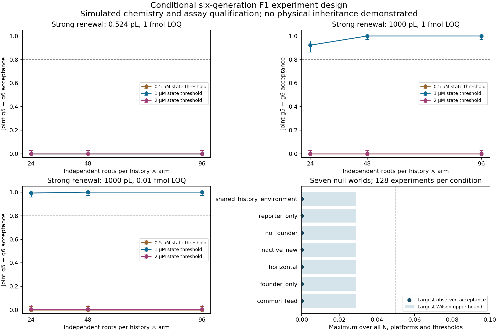

# Measuring new RNA function, retention and inheritance

15 October 2026. This laboratory turns the RNA model's unresolved mechanisms into a prospective experimental design and executable simulations. The central result is a measurement requirement: **new RNA identity and total activity must be combined with conservative bounds on all older and nuisance catalysts before activity can be attributed to new F1**. The simulations test that observer and its limits. No physical assay or living entity was created.

## Why the previous model failed

The [RNA investigation](../rna-mechanism-2026-10-15/REPORT.md) independently reproduced the original failure before adding transport: bulk RMSE was 7.866 percentage points. A source-supported Hyper-A-assisted reporter route was missing, and reporter product was an indirect observer of active F1. Adding substrate occupancy and precursor-assisted alternatives improved whole-dose cross-validation RMSE from 9.798 to 9.509 points, only 2.95%; the full-data fit slightly worsened. The occupancy scale reached its imposed upper bound and the optional accessible-reporter fraction reached one. These mechanisms were not quantitatively identified by those observations.

Both revised exchange models and all eight retention scenarios failed the accuracy screen. These outcomes do not establish one unique cause of failure. They show that the tested reaction family, transport assumptions and observer cannot adequately explain the data together. Better fitting cannot reconstruct missing absolute active-catalyst measurements or parent–daughter identities.

The present laboratory therefore preserves chemical identities, ligation stoichiometry and finite material accounting while exploring explicitly hypothetical kinetic and measurement scenarios. It does not import the failed fit as calibrated chemistry.

## Three experiments and their decision rules

The complete [experimental specification](EXPERIMENTS.md) separates qualification, retention and tracked generations.

| Experiment | Measurements | Admission requirement |
|---|---|---|
| A. Identify new functional F1 | Full-length wild-type identity and A–B junction; founder/ordinary/terminal isotope codes; separate native-recovered and refolded activity aliquots | Calibrated label effects, recovery, cross-contamination, nuisance-mixture response, specific-capacity bounds and LOQ |
| B. Separate loss from inactivation | Before/after inside, outside and surface amounts, volumes and activity; first without ligatable feed | Account for recovery and missing fractions; distinguish molecular retention, capacity retention and specific-capacity change |
| C. Test inherited catalytic state | Physical parent/daughter trees, randomized high/low root states, intact/reset controls, terminal-generation pulse, same-root terminal pools | New-capacity evidence at two generations; conservative ancestry contrast under common conditions; explicit import and missing-pedigree bounds |

F1 and Cy5-F1 are both 66 nucleotides long. Reporter carries G38A and Cy5; length alone is insufficient. An inactive wild-type molecule can have the same sequence and mass as an active one. These distinctions follow the [primary study](https://doi.org/10.1038/s41467-023-36940-z) and are checked against its exact SI sequences in the [assay ledger](research/assays/ledger.json).

Isotope mass spectrometry establishes provenance and consumes its sample. It does not sort isotopologues for a subsequent activity assay. With matched aliquots, the prospective observer computes:

```text
new capacity lower bound = max(0,
    total capacity lower bound
  - pre-existing F1 amount upper bound × maximum specific capacity
  - precursor/reporter nuisance upper bound
  - imported catalyst upper bound)
```

The lower bound is conditional on experimentally qualified capacity and nuisance envelopes. Unknown calibration produces an unresolved result. Native-recovered activity and activity restored by refolding remain separate; neither proves the original in situ fold.

Four [executable exact counterexamples](counterexamples.py) establish why weaker observers fail: origin/activity marginals admit different new-active amounts; unknown recovery mimics retention; unresolved surface binding mimics lumen retention; and missing surface fractions hide whether material adsorbed or degraded. These are mathematical witnesses, not noisy fit comparisons.

## Observed assay and retention operating characteristics

The [assay campaign](assay/REPORT.md) comprises 8,960 assay observations and 8,192 paired fraction observations under frozen planning assumptions. Its 1 fmol recovered LOQ, 50% recovery and uncertainty margins are hypothetical specifications for qualification.

| Tested condition | Simulated outcome |
|---|---|
| 100 fmol new active capacity, 0 or 10 fmol founder | 256/256 detections; 95% Wilson lower bound 98.52% |
| Same new capacity, 100 fmol founder | 52/256 detections: 20.3%; fails the 80% power target |
| 10 fmol new active capacity | 0/256 detections at each tested founder amount |
| Each native null condition | 0/256 false positives; casewise 95% upper bound 1.48% |
| Refolding-only control | 0/256 native detections; 256/256 refolded detections |
| 60% inactivation, matched paired contrast | 256/256 detections at both tested retention levels |
| No inactivation, matched paired contrast | 0/256 false inactivation calls at both retention levels |

The matched contrast cancels specified shared multiplicative calibration errors. Differential extraction damage or molecular/activity recovery would invalidate that cancellation and must be checked experimentally. Marginal intervals detect only 6–11 of the 256 inactivation cases. At 80% actual molecular retention, the median molecular interval is approximately [0.480, 1.332], too broad to resolve a modest 20% loss. New-age active retention also remains an interval, not an exact active fraction. One qualified mass-balance scenario covers truth in 255/256 replicates, so these intervals are not absolute guarantees.


Lines connect tested points only. All cases, qualification failures and coverage intervals are retained in [summary.json](assay/results-v1/summary.json) and [retention.json](assay/results-v1/retention.json). The power and false-positive targets are casewise planning criteria, not a familywise guarantee.

## Physical generations and material feasibility

A 10-µm spherical vesicle at 1 µM contains approximately **0.524 amol** of RNA. At the assumed 1 fmol activity LOQ, 50% recovery and one-quarter activity aliquot, at least **15,279 vesicles** are needed even if all RNA is active target material. If only half is the relevant new functional product, the count doubles. This lower bound precedes founder and nuisance subtraction. Increasing unrelated-root replication does not solve a sub-LOQ sample.

The lineage design instead tests same-root terminal pools and larger-compartment scenarios. It preserves complementary daughter partitions, finite feed, inactivation, external loss, imported catalyst and destructive sampling. Six physical divisions are explicit. Generation 5 contributes 16 sacrificed tips per root; their sisters continue and contribute 32 terminal tips at generation 6. Parent and daughter IDs, volume changes and external material supplies are recorded. No destroyed tip continues.

A terminal-generation isotope pulse distinguishes synthesis in the sampled generation from synthesis in its ancestors. The nuisance subtraction includes all pre-pulse F1. The fixed sequence means the tested outcome is persistence of a parent-dependent catalytic state with current-generation renewal, not inherited genetic variation. Published [mechanical liposome division](https://doi.org/10.1021/acsnano.7b08411) provides an engineering precedent under different lipid and solution conditions; repeated compatible F1 growth/division remains to be qualified.

The [lineage campaign](lineage/REPORT.md) ran 3,456 independent simulated experiments: nine worlds × three platforms × 128 replicates. It retained **2,654,208 root-pool observations** and 31,104 decisions across three root counts and three state thresholds, with corresponding shuffled-history diagnostics. Each decision must pass at both generations 5 and 6. The world assumptions and full source snapshot are in [the frozen protocol](lineage/PROTOCOL.md) and [freeze.json](lineage/results-v1/freeze.json).

The strong scenario assumes four new F1 products per existing active molecule per cycle, 90% functional product, 10% molecular loss and 5% inactivation, subject to finite substrates. These are planning assumptions, not fitted or measured rates. Under that scenario, the 1 µM new-capacity state threshold produced:

| Per-compartment volume / recovered LOQ | 24 roots per history × arm | 48 roots per history × arm | 96 roots per history × arm |
|---|---:|---:|---:|
| 0.524 pL / 1 fmol | 0/128 | 0/128 | 0/128 |
| 1 nL / 1 fmol | 118/128 | 128/128 | 128/128 |
| 1 nL / 0.01 fmol | 127/128 | 128/128 | 128/128 |

The 118/128 result has a 95% Wilson interval of 86.22–95.70%, above the 80% planning power target. For 128/128 the lower bound is 97.09%. These root counts are **per group**: 48 means 192 independent roots across high/low history × intact/reset arms, distributed over four batches. Their two terminal generations require 9,216 sampled compartments, pooled by root and generation. A spherical 1-nL compartment would be approximately 124 µm in diameter; the published small-vesicle division precedent does not qualify this platform.

All 0.5 µM threshold designs failed; at 2 µM only one of 128 experiments passed in each larger/sensitive-platform root-count condition. Weak renewal failed throughout. The low threshold no longer establishes low/reset descendants as below the cutoff as they accumulate new function, while the high threshold exceeds many conservative lower bounds. The 1 and 2 µM thresholds were added during development, declared before official seeds, and all outcomes are reported. They are absolute state cutoffs, not estimated minimum detectable differences or physical sensitivity specifications.

Each of the seven alternative-explanation worlds returned 0/128 positive inheritance decisions in every tested condition: founder-only/no regeneration, newly made inactive F1, inactive-founder/reporter background, no founder, common-feed recreation, horizontal active import, and history-correlated external conditions. Whole-root history shuffling within batch and intervention arm also returned zero positives. Each null cell's 95% upper bound is 2.91%; this is casewise evidence under the supplied noise and nuisance models, not universal exclusion of contamination or a familywise error guarantee.



The first three panels show strong renewal. Weak renewal fails throughout. All 243 evaluated design cells remain in [summary.json](lineage/results-v1/summary.json). Missing samples and uncertain pedigrees remain in denominators. Coverage uncertainty uses independent simulated experiments rather than treating related descendants or shared-calibration measurements as independent. All qualified new-capacity intervals covered truth in every experiment; the finite-simulation lower Wilson bound on that all-covered event is 97.09%, despite a zero-variance empirical mean interval.

An independent no-feed retention cohort at each platform still gave broad bounds. The larger-platform native retention interval averaged approximately [0.514, 1.429] around simulated retention of about 0.855, so small losses remain poorly resolved. The small-vesicle cohort remained unresolved. Computational conservation and pedigree correctness do not qualify the chemistry or instruments.

## Datasets that constrain the next physical model

The completed [dataset investigation](../rna-mechanism-2026-10-15/REPORT.md#new-public-datasets-and-what-they-constrain) retains raw downloads, hashes, conditions and normalized exports. It includes 529 observations from the original RNA study, 100 new retention/exchange rows, 1,837 Azoarcus network compositions, 20,039 droplet records, 182 functional replication entries and a 14-FASTA fidelity archive.

| Source | Constraint for this design | Remaining gap |
|---|---|---|
| [Ghosh 2025](https://doi.org/10.1038/s41467-025-63656-z) | Ribozyme partition and catalytic activity must be measured separately | Different ribozyme/coacervate chemistry; apparent rate includes both phases |
| [Le Vay 2023](https://elifesciences.org/articles/83543) | Reaction and polymerization can change exchange | Substrate/concatemer mixing does not measure active F1 retention |
| [Ameta 2021](https://doi.org/10.1038/s41467-021-21000-1) | Background assembly can erase memory of starting composition | Sample barcodes do not provide physical multigeneration pedigrees |
| [Mizuuchi 2022](https://doi.org/10.1038/s41467-022-29113-x) | Sequence variants can be connected to functional replication interactions | Protein replicase and supplied translation machinery; not R3C/POPC |
| [Gianni/QT45 2026](https://doi.org/10.1126/science.adt2760) | Sequence copying and functional-product assays are distinct endpoints | Fidelity archive checked, not re-estimated; no compartment-inheritance assay |

These sources constrain model structure and experimental controls. They do not supply interchangeable rate constants for the failed F1 model. The supplementary [assay](research/assays/REPORT.md) and [lineage](research/lineage/REPORT.md) reviews add identity, isotope analysis, sample-splitting and physical-division precedents with explicit qualification gaps. No reviewed dataset establishes newly generated active F1 retained across matched physical parent–daughter generations.

## Verification and disposition

The [complete offline verification](verification-v1/verification.json) passed 17 model tests and 74 recorded exact comparisons/source checks. It independently reran both campaigns, compared all 27 compressed lineage datasets by numerical content, and reproduced scientific JSON, decisions and complete illustrative pedigrees exactly. Current scientific inputs and both archived source snapshots were verified. The exact counterexamples and eight source-identity checks passed. The lineage design's six-check receipt and its source hashes were verified. All 397 checked non-hidden, non-cache files in the two preceding laboratories remained unchanged during verification.

The [completion audit](checks.md) maps every original requirement to evidence. [Reproduction instructions](README.md) use the pinned existing Python environment and refuse existing output directories. ZIP container timestamps and execution times are excluded from comparison; scientific values are compared exactly. The figure data were checked and both figures visually inspected.

Development attempts remain available. Independent review caught a contrast-accumulator defect introduced while adding the threshold grid; it was corrected and given a known-contrast regression before the official campaign. Failed and inconclusive designs were retained. No official result was tuned into a positive outcome. [Independent review](../.omo/evidence/rna-inheritance-design-code-review.md) approves the bounded computational deliverable with no blockers; its remaining low-priority note concerns untyped interfaces.

No wet experiments, author correspondence, instrument qualification or full sequencing reanalysis were performed. The unresolved physical requirements are a calibrated joint provenance/function observer, compatible repeated growth/division, and measurements of active catalyst loss, inactivation and current-generation renewal.
