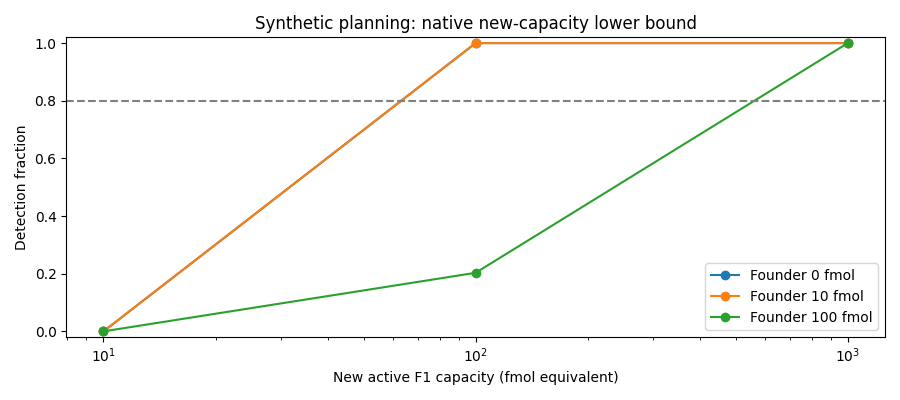

# Assay and retention simulation

This is a prospective synthetic design, not measured F1 performance. The [source ledger](../research/assays/ledger.json) supplies molecular identities and measurement requirements. Every numerical calibration, recovery, error, specific-capacity bound and LOQ in [the frozen protocol](PROTOCOL.md) is an explicit planning assumption. No failed RNA-model rates were transferred.

## What the measurement can establish

Founder-heavy and new-light full-length wild-type RNA are quantified separately from Hyper-A and G38A/Cy5 reporter. Matched aliquots supply native-recovered and refolded F1-equivalent capacity. Isotope analysis is destructive; it does not physically sort old/new active molecules. [Two exact latent worlds](results-v1/nonidentifiability.json) share founder=10,new=10,total-capacity=10 while new-capacity is0 or10. The API therefore computes a conservative lower bound, not a joint active-molecule measurement:

`max(0, total-capacity lower − founder upper×specific-capacity upper − nuisance-mixture upper − imported-capacity upper)`.

An above-LOQ lower bound requires positive new-wild-type identity, qualified labelling, recovery, and additive or empirically bounded mixture responses. Failed qualification, small material budgets and inconsistent identity/activity intervals return unresolved. A refolding-only control can identify refoldable capacity but never native-recovered activity. Neither measurement proves the in situ fold.

## Frozen campaign and observed operating characteristics

Seed namespace `[20261015,5101]`,256 independent synthetic batches per case. There are35 assay scenarios (8,960 measurements) and8 paired retention scenarios (8,192 before/inside/outside/surface measurements). Raw measurements and all decisions are retained in [observations.jsonl](results-v1/observations.jsonl) and [retention_observations.jsonl](results-v1/retention_observations.jsonl). All scenarios remain in [summary.json](results-v1/summary.json), including failures.

Under the assumed1fmol recovered LOQ and50%recovery:

| Native new-active capacity | Founder amount | Detections/256 | Outcome |
|---|---:|---:|---|
|10fmol|0,10,100fmol|0 each|Insufficient power|
|100fmol|0 or10fmol|256 each|Power target met|
|100fmol|100fmol|52|20.3%power; target fails|
|250fmol in1000fmol new RNA|0,10,100fmol|256 each|Power target met|
|1000fmol|0,10,100fmol|256 each|Power target met|

Every null grid case had0/256 false positives; each95%Wilson upper bound is1.478%. Cases with256/256 detections have95%Wilson lower bound98.522%. These conditional planning targets are>=80%power and<=5%false positives, evaluated casewise, not a familywise guarantee. All qualified new-capacity intervals covered their true synthetic target256/256 (Wilson lower98.522%). Qualification-failure cases stay unresolved; coverage is null rather than pretending absent intervals cover truth. The refolding-only case reports native0/256 and refolded256/256.



Lines connect tested points only; intermediate power or a physical detection threshold was not established.

## Retention: loss versus inactivation

The nonreacting standard mixture contains100fmol founder and900fmol new-labelled F1, with800fmol equivalent capacity. Physical material is conserved across inside, outside and surface fractions. Extraction recovery differs deliberately: inside.3,outside.8,surface.5. Matched standards make those corrections available; the unknown-recovery controls produce no admitted retention or mass-balance interval.

Marginal before/after intervals are broad. At actual80%material retention without inactivation, median molecular-retention interval is[.480,1.332] and capacity-retention interval[.479,1.330]. These intervals do not resolve a modest20%loss. At30%retention, median molecular interval[.180,.499] supports major loss. Do not clip wide intervals to manufacture precision.

A matched capacity-per-molecule contrast cancels the shared multiplicative response/recovery-calibration factor. With60%inactivation, its median interval is approximately[.267,.597], compared with[.669,1.493] when no inactivation occurs. It detects inactivation256/256 in both retention arms and makes0/256 false calls in both no-inactivation arms. All paired contrast intervals cover truth256/256. This cancellation requires same-batch calibration and equivalent molecular/activity recovery within each fraction; differential fold damage would break it. Unpaired marginal intervals detect only11/256 and6/256 of the same inactivation cases, so paired sampling is consequential.

New-age active retention remains only bounded: with80%material retention and60%inactivation (true new-capacity retention.32), median interval is[.071,.698]. Without inactivation at80%retention, it is[.359,1.746]. The simulated observer does not exactly assign activity to the new isotope cohort. Molecular mass-balance coverage is255/256 in one qualified scenario and256/256 in the others; Gaussian-error intervals are not absolute guarantees.

## Material feasibility and implementation

A10µm spherical GUV at1µM has0.523599pL and0.000523599fmol RNA. Even if all RNA is the desired functional product, the assumed1fmol recovered capacity LOQ needs at least15,279 such vesicles with50%recovery and one-quarter activity aliquot. If only half is functional new material, at least30,558 are needed. This is an arithmetic lower bound before conservative founder/nuisance subtraction. The full [material-budget scan](results-v1/material_budget.csv) records diameter,pool size,new fraction and each aliquot's recovered material. Pooling changes the estimand; it does not establish individual-daughter competence.

Nine unit tests passed; [test log](tests-development-v3.log). Independent reviewer cleared the design before official seeds. A fresh process reproduced all10 output artifacts byte-for-byte, including raw observations, figure and source snapshot: [replay verification](replay-verification.json). Source hashes and exact configuration are in [freeze.json](results-v1/freeze.json). The official source snapshot is [source.zip](results-v1/source.zip); later report text does not change the frozen scientific implementation.

Reproduce with the pinned runtime used by the previous laboratory:

```sh
uv run --offline --no-project --python /USER_HOME/.pyenv/versions/3.12.3/bin/python3 --with numpy==2.4.1 --with scipy==1.16.1 --with matplotlib==3.10.8 --with openpyxl==3.1.3 python rna-inheritance-design-2026-10-15/assay/run.py --output NEW_DIRECTORY
```

The API is `observe(amounts,capacities,rng,calibration=None,volume_pl=...)`, then `infer(observation)`. Amount keys:founder,new,hyper,reporter,imported; capacity keys:native,refolded. Both use original-sample fmol or fmol F1-equivalent. No truth fields enter inference. The simulator's volume is recorded provenance; feasibility derives from actual supplied molecule amount and aliquot budgets.

Skipped physical assays and instrument qualification. Primary risks are unmeasured F1-specific LOQ, specific activity, label effects, nuisance nonadditivity and native-state recovery; simulated success does not validate these assumptions.
