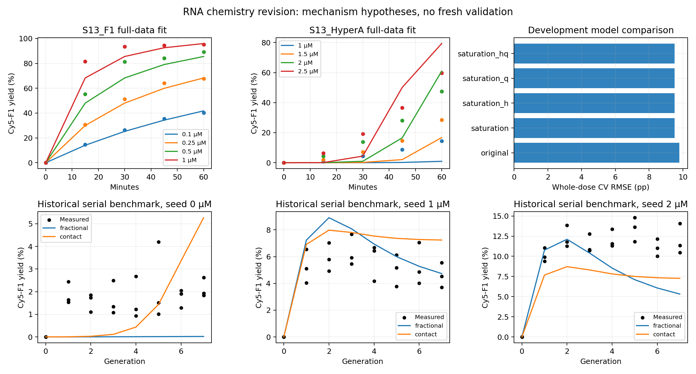

# RNA mechanism revision: scope and interpretation

The chemistry-structured revision makes the assumptions and species accounting clearer, but it **does not resolve the prediction failure**. Whole-dose cross-validation improves by only 2.95%, both compartment models fail the original adequacy screen, and all eight active-retention scenarios fail. This is a completed negative model-comparison study, not a validated chemical mechanism. No result was selected from the historical transfer benchmarks.

## Results

All 40 candidate/fold fits resolved. Each fold omits one complete dose curve; the pooled score includes 40 summary means, including the eight structural zero-time observations. The same fitting budget applies to the original and all new candidates.

| Chemical candidate | Parameters fitted | Whole-dose CV RMSE (pp) | Full-data RMSE (pp) |
|---|---:|---:|---:|
| Original | 3 | 9.797886 | 7.866012 |
| B occupancy, selected | 3 | 9.508726 | 7.892929 |
| B occupancy + direct Hyper-A reporter route | 3 | 9.517363 | 7.889656 |
| B occupancy + accessible fraction q | 4 | 9.508728 | 7.892929 |
| B occupancy + direct route + q | 4 | 9.517395 | 7.889656 |

The fixed simplicity rule selects the three-parameter occupancy candidate without a direct Hyper-A reporter route. This ranking is modest development evidence, not statistical proof of improvement. Its full-data fit is slightly worse than the original. KB reaches its 100 µM upper bound; the profile RMSE decreases monotonically from 9.180 pp at KB = 0.01 µM to 7.893 pp at 100 µM, favoring the near-unsaturated limit over the tested range. **B saturation is not identified.** q reaches 1 in both optional-q candidates, so this family supplies no positive evidence for an inaccessible fraction. These boundary results do not demonstrate that all real RNA is accessible or that real chemistry never saturates.

Selected effective parameters are kF = 1.519173 µM^-1 min^-1, kH = 0.000369752 µM^-1 min^-1 and KB ≈ 100 µM; q is fixed at 1. The residual-Jacobian singular values are 901.310, 33.023 and 0.8575, with KB at its boundary. These are fitted effective scales, not independently measured molecular constants. Exact values, optimizer statuses, boundaries and all residuals are retained in `results-v2/full_fits.json` and `kinetic_predictions.csv`.

| Coupled transport closure | Fitted m per FT | Calibration RMSE (pp) | Historical benchmark RMSE (pp) | Maximum absolute group-mean error (pp) | Screen |
|---|---:|---:|---:|---:|---|
| Original frozen model | 0.067396 | 1.072022 | 3.322380 | 6.889946 | Fail |
| Revised fractional exchange | 0.066511 | 1.088235 | 3.279569 | 6.944619 | Fail |
| Revised contact exchange | 0.032951 | 0.778890 | 3.593807 | 7.088670 | Fail |

The historical benchmark pools 72 nonzero-time replicate observations. Its registered screen requires RMSE ≤ 2 pp **and** maximum absolute group-mean error ≤ 4 pp. Fractional exchange improves pooled RMSE by only 0.043 pp while worsening the maximum mean error. Contact exchange fits its 18 calibration replicates better but transfers worse overall. Neither is selected by this comparison. Both also fail separately on Figure 2's 2 µM seed and on Figure 3.

| Active F1 retention over three FT | Fractional benchmark RMSE (pp) | Contact benchmark RMSE (pp) |
|---|---:|---:|
| 0.30 | 4.668148 | 3.994155 |
| 0.55 | 3.279569 | 3.593807 |
| 0.80 | 3.273252 | 3.687892 |
| 0.95 | 3.806321 | 3.785427 |

Fragment retention remains 0.55; only transport is refit on its original calibration set. Every scenario fails the joint screen. We do not choose 0.80 retention from its small retrospective RMSE advantage. It is an assumed scenario, not a measurement or confidence interval.

No-regeneration and no-exchange controls perform worse on Figure 3: RMSE 6.491/7.650 pp for fractional exchange and 6.775/7.650 pp for contact exchange. This model-level comparison does not prove that physical catalyst regeneration is uniquely measured by the assay. The new same-condition S13 negative control is predicted exactly 0% at 0 and 60 minutes, matching workbook cells C6/C10.

## Verification and retained evidence

The full repaired run exits 0 and records a source/output manifest. Ten unit-test scenarios pass. All six integration refinements pass the 1e-4 pp criterion; the largest difference is 3.784e-6 pp. Maximum serial moiety-balance residual is 6.301e-15 µM. Fresh-process replay reproduces all 216 benchmark predictions exactly and verifies frozen-source/output hashes. The figure was visually inspected after generation.

| Scenario | Invocation from this directory (runtime prefix in README) | Binary observable | Artifact |
|---|---|---|---|
| Conservative kinetics, observer, exchange, founder carryover and input validation | `python -m unittest -v test_model.py` | Exit0;10 tests OK | `tests-v2.log` |
| Five-candidate frozen study, both transport closures, all controls/sensitivity | `python run.py --output results-v2` | Exit0;40 resolved CV folds; complete manifest | `run-v2.log`, `results-v2/manifest.json` |
| Numeric accuracy and mass balance | Same full-study invocation | Six refinement pass flags true; balance residual<1e-6µM | `results-v2/refinement.json`, `results-v2/summary.json` |
| Saved-parameter independent-process replay | `python run.py --replay results-v2` | Exit0;216 comparisons, maximum difference0; hashes match | `replay-v2.json` |
| Serialization repair has no substantive scientific effect | Compare all five chemical-fit artifacts and216 stored predictions across retained attempts | Five artifacts byte-identical; maximum prediction difference<1e-8pp | `repair-comparison.json` |

`results-v1` is a deliberately retained partial run: JSON serialization failed after the numerical work. The native-float boundary repair and regression test are documented in `RUN_REPAIR.md`; the entire study was rerun as `results-v2`. The code, candidate set, parameters, bounds, folds and fitting budget were not tuned after looking at outcomes.

## What the failure means

The original model fails before membrane transport is introduced: its S13 bulk calibration RMSE is 7.866 percentage points. The source audit independently reproduced the old residuals. It underpredicts Hyper-A 1µM at60minutes (0.961% versus14.401%) and overpredicts Hyper-A2.5µM at60minutes (78.974% versus59.730%). It also underpredicts F1-driven early ligation. This is a dose/time-shape mismatch, so refitting only transport or retention cannot repair the chemical calibration.

The original Ki reaches its1000µM upper bound, making its fitted inhibition nearly absent. The model's A²B² background term was only a coarse interpretation of a2A/2B secondary-structure proposal. SI13b also explicitly proposes Hyper-A-assisted reporter ligation; the original model required every reporter reaction to wait for newly formed F1. That missing route is a supported topology hypothesis. The rate order and equality of catalytic coefficients are not independently measured.

## What changed

The new family uses saturating B occupancy, shared-coefficient precursor-assisted catalysis as an explicit alternative, and an optional common accessible-reporter fraction. The inaccessible reporter remains an explicit chemical reservoir and contributes to the observed denominator. Inactive Cy5-F1 never contributes to catalyst concentration. Every reaction, exchange, loss and feed event has an explicit moiety balance. We compare the original model and four bounded alternatives by leaving entire dose curves out, with the same fixed optimization budget.

The B occupancy expression approximates association without tracking bound intermediates. Its fitted KB is an effective scale, not an independently measured dissociation constant. All S13 curves share one initial B concentration, so KB, kF and kH may be confounded. Each net ligation consumes one A or reporter plus one B; the effective association coefficient absorbs unresolved complex event multiplicity.

Two conservative horizontal-exchange models use the same one-parameter transport calibration. Fractional exchange dilutes every cohort toward the mean; contact exchange merges a fraction of each cohort into one new mixed cohort and leaves the remainder separate. Both describe supplied GUV populations. Neither creates offspring or simulates compartment division.

## Limits of the comparison

All published values have already been seen. Whole-dose cross-validation helps compare these declared candidates; it does not create an untouched experimental validation dataset. Figure2 dose2 and Figure3 are historical development benchmarks. Both transport models and every active-retention scenario are reported without choosing a model or retention value from those benchmarks.

The bulk and GUV interiors have matched nominal buffer but different membranes, mixing and potentially folding/accessibility. Transferring the fitted common q into GUVs is unmeasured. Bulk Hyper-A calibration covers1–2.5µM while the fresh GUV substrate population contains10µM, creating an additional concentration extrapolation in incompletely mixed cohorts. The source's approximate45% loss over three FT cycles does not separately measure survival of catalytically active F1. Its sensitivity range is a set of scenarios, not confidence limits.

New S13 negative-control values are usable as a same-condition structural check. S12, S15 and S18 differ in sucrose, concentration or protocol; the source audit retains them as separate experiments. They do not calibrate this model's missing active-F1 retention or establish lineage inheritance. See [source audit](../sources/salibi/audit.md) and [conditions](../sources/salibi/conditions.json).

Reporter formation, ongoing production and active RNA propagation are distinct from parent-daughter functional inheritance. Because Hyper-A-assisted reporter catalysis is itself proposed, even new Cy5-F1 production is not unique evidence of newly made active F1. These aggregate PAGE observations contain no tracked parent-daughter identities and do not separately quantify newly made active F1 in descendants. A good fit would leave that inference unresolved.
