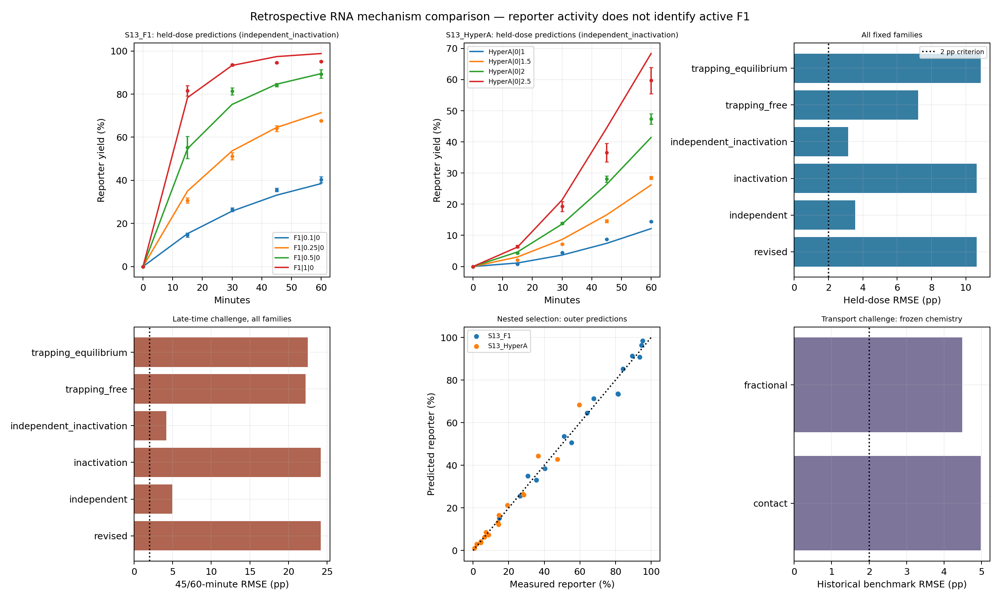

# Why the revised RNA model fails, and what alternative chemistry can explain

The best tested development model separates active-RNA and reporter reaction efficiencies and allows loss of F1 catalytic competence. It reduces whole-dose prediction RMSE from **10.631 to 3.145 percentage points**, but still fails the registered accuracy screen. Nested model selection gives **3.551 pp**, also a failure. This is an improved reduced model, not an identified physical mechanism.

The later-time and historical transport tests also fail. The completed investigation preserves all six candidates and failed starts. Independent replay and a complete fresh-process refit reproduce the scientific outputs; successful reproduction does not make the chemistry adequate.

Points in the first two panels are published means with SD bars; lines connect predictions from the corresponding dose holdouts. The displayed combined family was chosen using ordinary dose validation. The nested panel uses separate outer-fold predictions. The dotted 2 pp lines show the RMSE component of the screen; maximum-error limits are additionally required. The frozen original figure is preserved; this rendering reduces panel-title size for readability.

## The previous model has a testable structural defect

The failure already occurs in the membrane-free assay. When Hyper-A is absent, the previous model keeps active F1 constant and has the form `dP/dt = F0 g(P)`. It therefore predicts the same reporter yield for the same initial-F1-concentration × time exposure. Changing its common substrate saturation constant or accessible-reporter fraction cannot remove this restriction.

At an exposure of 15 µM·min, the published means are 67.698% for 0.25 µM F1 at 60 minutes, 81.306% for 0.5 µM at 30 minutes, and 81.550% for 1 µM at 15 minutes. The maximum discrepancy is 13.852 percentage points. This contradicts the reduced constant-activity model under the nominal assay conditions. It does not identify whether activity changes with time, concentration-dependent binding matters, or unmodeled preparation/assay effects contribute.

The Hyper-A curves have another problem: too little early reporter followed by too much high-dose acceleration. The selected previous family forces the same F1-mediated efficiency for active and reporter substrates and omits a separate precursor-assisted reporter route. The previously tested optional route tied its efficiency to the active initiation rate. These reductions couple two observables that are chemically distinct: inactive reporter product and catalytically active full-length RNA.

The [diagnostic replay](diagnosis/REPORT.md) checked 120 source-workbook values and reproduced 400 earlier predictions exactly. Removing eight deterministic time-zero values exposes the informative score: the earlier revised model's whole-dose prediction RMSE is 10.631 pp, rather than the 9.509 pp score that includes the zeros.

## What was tested

Six fixed candidate conditions cover three changes: separate active/reporter reaction efficiencies, loss of F1 catalytic competence, and reversible nonproductive substrate binding. The set includes a prescribed combination of separate efficiencies plus inactivation, and two binding preparations: all substrates initially free or initially equilibrated. The [protocol](PROTOCOL.md) states every rate equation, unit, parameter bound, start and selection rule. All eight states conserve three RNA moiety inventories. Inactive products and nonproductive complexes cannot catalyze.

The PAGE observer counts fluorescent ligated product. It does not measure active F1. The F1→inactive transition represents loss of competence without fragmentation; it is not a chemically explicit RNA-hydrolysis reaction. Binding complexes are proposed coarse states, not experimentally identified Salibi intermediates. The preparation variants are limiting assumptions because preparation on ice followed by magnesium addition does not determine initial strand occupancy.

Independent reaction efficiencies and competing complexes are motivated by primary kinetic work on this RNA system and related ligases. Those papers use different substrates, reporter designs, buffers or temperatures, so their measured constants were not transplanted into the present assay. The [source ledger](research/REPORT.md) records support and exclusions, including [Salibi et al.](https://doi.org/10.1038/s41467-023-36940-z), [Ferretti and Joyce](https://doi.org/10.1021/bi301646n), [Robertson and Joyce](https://doi.org/10.1016/j.chembiol.2013.12.004), and [Olea and Joyce](https://doi.org/10.3390/molecules21101310).

## Held-out design and interpretation

The measured inputs are eight S13 dose curves, each summarized at 0, 15, 30, 45 and 60 minutes with n=3. Only the 32 positive-time means enter fitting and primary scores. Raw replicate trajectories and their covariance are unavailable; the fit is unweighted and no chi-square significance claim is made.

Each fixed family is fitted to seven complete doses and predicts the eighth. A nested analysis chooses the family using only inner holdouts within the outer training data. The outer dose never selects the family. A separate time challenge fits 15/30-minute observations and predicts 45/60-minute observations for every family. All source observations had been inspected earlier: these are retrospective prediction checks, not blinded experiments or independent experimental replication.

All fits receive six fixed starts and `max_nfev=160` per start; numerical derivative evaluations are additional. Numerical failures remain in the record. One unresolved fold makes a pooled validation score unresolved. A fit's numerical termination is distinct from agreement between starts or chemical adequacy. The new pragmatic bulk screen is RMSE≤2 pp and maximum held-out error≤4 pp; lower error alone does not pass it. Full-fit integration refinement and material-balance checks additionally qualify adequacy claims.

## Results

### All fixed candidates

Primary scores exclude the eight deterministic time-zero observations. Every family resolved all eight dose folds. The final development choice uses the registered simplicity rule on these dose scores; its score is therefore selection data. The nested score below assesses the selection procedure separately.

| Candidate | Parameters | Full-data RMSE, pp | Held-dose RMSE, pp | Maximum held-dose error, pp | Bulk screen |
|---|---:|---:|---:|---:|---|
| Revised comparator | 3 | 8.825 | 10.631 | 23.093 | fail |
| Independent reaction efficiencies | 5 | 2.721 | 3.551 | 8.552 | fail |
| Inactivation alone | 4 | 8.825 | 10.631 | 23.093 | fail |
| Independent efficiencies + inactivation | 6 | 2.014 | **3.145** | 8.639 | fail |
| Trapping, initially free | 5 | 5.435 | 7.228 | 20.666 | fail |
| Trapping, initially equilibrated | 5 | 8.277 | 10.869 | 25.413 | fail |

The combined candidate improves pooled held-dose RMSE by about 70%, but improvement is not uniform. Inactivation alone returns to its lower rate bound and scarcely changes the comparator. The trapping results depend on preparation and remain inaccurate. These are retained negative results for the registered reductions; they do not exclude every possible binding or inactivation mechanism.

| Held dose, µM | Revised RMSE, pp | Combined-model RMSE, pp |
|---|---:|---:|
| F1 0.1 | 1.152 | 1.601 |
| F1 0.25 | 3.283 | 3.094 |
| F1 0.5 | 10.738 | 3.062 |
| F1 1 | 9.032 | 2.790 |
| Hyper-A 1 | 8.301 | 1.349 |
| Hyper-A 1.5 | 13.087 | 1.761 |
| Hyper-A 2 | 11.874 | 3.104 |
| Hyper-A 2.5 | 17.720 | 5.939 |

Holding out the lowest or highest dose of a branch tests concentration extrapolation; interior holdouts test interpolation. The highest Hyper-A dose remains especially difficult. Even the lowest F1 dose becomes slightly worse under the combined candidate.

Nested selection chooses the combined model in five outer folds and independent efficiencies alone in three. Its 32 outer positive-time predictions give RMSE **3.551 pp** and maximum error **8.639 pp**. The prespecified limits are 2 and 4 pp. The additional inactivation parameter is therefore not consistently preferred across the small training subsets. Exact choices, all inner scores and training identities are in [validation.json](results-v1/validation.json) and [splits.json](results-v1/splits.json).

### Later times remain a failed prediction challenge

These fits see only 15/30-minute means and predict the 16 means at 45/60 minutes. No family is selected using these outcomes.

| Candidate | Late-time RMSE, pp | Maximum error, pp | Screen |
|---|---:|---:|---|
| Revised comparator | 24.183 | 56.503 | fail |
| Independent efficiencies | 4.954 | 11.351 | fail |
| Inactivation alone | 24.183 | 56.503 | fail |
| Independent efficiencies + inactivation | **4.148** | 8.220 | fail |
| Trapping, initially free | 22.224 | 47.215 | fail |
| Trapping, initially equilibrated | 22.496 | 47.533 | fail |

The combined candidate improves extrapolation but does not meet the 2/4 pp limits. The large deterioration of trapping models at later times shows why a better full-data fit is insufficient. [Raw predictions](results-v1/predictions.csv) retain every dose, time and model error.

### What the fitted parameters do and do not constrain

The selected full-data effective parameters are `kf=0.147006`, `ka=0.0157193`, `kh=0.000683676`, `krh=0.000708265` µM⁻¹ min⁻¹; `KB=1.36120` µM; and `kd=0.0129467` min⁻¹. Thus this fit uses about nine times slower F1-mediated active-fragment ligation than reporter ligation. Its functional-loss term corresponds to a model half-life of 53.54 minutes. Neither ratio nor half-life is a direct biochemical measurement. In particular, the loss term cannot be interpreted as a measured RNA hydrolysis rate.

The selected full-fit SSE is 129.793 pp². All 20 fixed-grid nuisance-refit profiles resolve, but several parameter changes cost little reporter accuracy:

| Fixed profile value | Nuisance-refit SSE, pp² | RMSE, pp | Implication within this reduced family |
|---|---:|---:|---|
| KB=0.01 µM | 140.328 | 2.094 | Reporter curves do not tightly locate substrate saturation |
| ka=0.0001 µM⁻¹ min⁻¹ | 154.466 | 2.197 | Active-path efficiency remains sensitive to other fitted routes |
| krh=1e-8 µM⁻¹ min⁻¹ | 133.092 | 2.039 | A substantial direct precursor-assisted reporter route is not established |
| kd=1e-6 min⁻¹ | 236.987 | 2.721 | Nearly removing the loss clock worsens the fit within this family |

These are coarse objective profiles, not confidence intervals or hypothesis-test probabilities. The selected log-parameter Jacobian has six nonzero singular values and a condition ratio of about 86: there is no demonstrated exact local degeneracy in this particular fitted family. That does not identify the physical mechanism or guarantee narrow uncertainty. [All profiles](results-v1/profiles.json) include worse and boundary scenarios, including a high-loss profile with only one start near its best successful objective.

The model-dependent active inventory is consequential. At Hyper-A=2.5 µM and 60 minutes, the independent and combined full fits predict nearly identical reporter product (3.012 and 3.016 µM), but different active F1 (0.367 and 0.266 µM). The rejected revised comparator predicts 1.983 µM active F1. These are simulated inventories, not activity measurements. [State inventories](results-v1/bulk_state_inventories.csv) retain every family and time.

### Better bulk chemistry still does not transfer adequately

All six chemical parameters were fixed before fitting only mixing on Figure 2 seeds 0/1 (18 positive observations). The historical challenge comprises Figure 2 seed 2 and all positive Figure 3 generations (72 values). Both transport closures retain the earlier assumed 0.55 three-cycle material retention, including unmeasured active-catalyst and complex retention.

| Closure | Fitted mixing | Calibration RMSE, pp | Benchmark RMSE, pp | Maximum group-mean error, pp | Screen |
|---|---:|---:|---:|---:|---|
| Fractional exchange | 0.037239 | 1.414 | 4.479 | 9.207 | fail |
| Contact exchange | 0.029275 | 1.150 | 4.975 | 10.147 | fail |

Low calibration error does not carry through to the historical benchmark. The failures can arise from remaining bulk-chemistry inadequacy, transport closure, retention assumptions or compartment-specific conditions; these data do not isolate the cause. No chemistry or retention was retuned against the benchmark. [Transport results](results-v1/transport.json) and [trajectories](results-v1/transport_trajectories.json) retain both closures. Founder survival in those trajectories is conditional on the chosen loss/retention model. This is not physical division or a demonstrated parent–daughter inheritance process.

### Optimization and numerical evidence

The campaign contains 248 fits and 1,488 starts. All fits resolve under the registered rule of at least one successful finite start. **22 starts reach the evaluation cap**, and **six fits lack two-start agreement**: three trapping-free dose-subset fits, both trapping late-time fits, and the kd=1 min⁻¹ profile. Their records remain unchanged in [fits](results-v1/fits/). There is no claim of a certified global optimum. No selective retry, expanded budget or new candidate was introduced after scoring.

All six full fits pass integration refinement, batched-versus-separate calculation and moiety balance checks. The largest full-fit tolerance difference is 6.72e-7 pp; the largest batching difference is 3.87e-5 pp; moiety discrepancies are at most 1.07e-14 µM. Both transport refinements also pass. These numerical certifications apply to the registered full fits and transport scenarios; every individual validation-fold optimum was not separately tolerance-certified.

## Data still needed to identify active chemistry and inheritance

The targeted search found useful mechanistic measurements and additional assays, but no newly acquired compatible numerical holdout. Salibi S12 serial transfer, S15 membrane addition and S18 freeze/thaw data differ from S13 in composition, timing, dilution or unresolved sucrose conditions. S13d repeats endpoints. S10 supplies gels but no compatible new quantitative time-course table was identified. Related ligase papers constrain possible processes without supplying a same-condition active-F1 retention or parent–daughter functional-inheritance dataset.

The next measurements should discriminate these alternatives directly:

1. Measure F1 activity after substrate-free pre-incubation under the exact S13 conditions, alongside intact RNA amount. This separates loss of catalytic competence from loss of material.
2. Vary B independently and control premixing time; measure free and complexed substrate where feasible. This tests saturation and trapping rather than inferring both from a single fixed-B series.
3. Measure newly formed wildtype full-length RNA and its catalytic activity in parallel with Cy5 product. This separates active synthesis from the reporter pathway.
4. Pair active-catalyst amount and activity before/after compartment transfer with parent–daughter measurements over serial generations. This is needed to constrain functional retention and inheritance rather than treating reporter persistence as inheritance.

The earlier [inheritance assay-design laboratory](../rna-inheritance-design-2026-10-15/README.md) develops the measurement and sampling design. Its simulated feasibility results remain conditional. The present model comparison does not create new physical retention measurements.

## Reproduction and evidence

Commands are in the [README](README.md). The [official results](results-v1/summary.json) retain source/code snapshots, all start records, training/evaluation identities, raw predictions, full state inventories, profiles and transport trajectories. The campaign took 1,075 seconds in this run; wall time is environment-dependent.

All 30 software tests pass (23 model/validation tests before launch and seven independent-verifier tests). [Saved-parameter replay](saved-parameter-replay.json) reproduces 2,512 prediction rows exactly, with maximum SSE-rounding difference 3.64e-12. The [independent audit](independent-verification.json) checks 248 fits, 1,488 starts, 392 splits, 20 profile points and 240 state rows. A complete fresh-process refit matches 262 scientific files within absolute 1e-8 plus relative 1e-8 tolerance, with exact discrete choices and IDs. Both source snapshots and all ten prior-laboratory input hashes remain intact. Clocks and plot bytes are excluded from numerical refit comparison; the report figure was visually checked separately.

Requirement-level acceptance is recorded in [checks.md](checks.md), with the independent code/science review linked there. The investigation is complete; every predictive adequacy screen is a retained negative result. No wet experiment, new compatible external numerical holdout, active-retention measurement, or demonstration of functional inheritance was produced.
