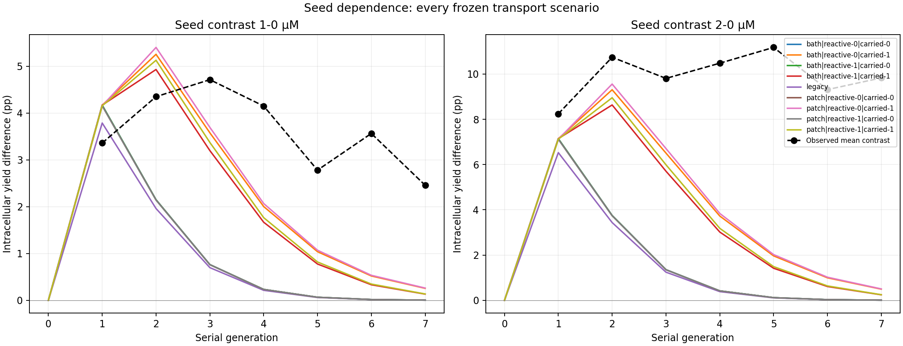
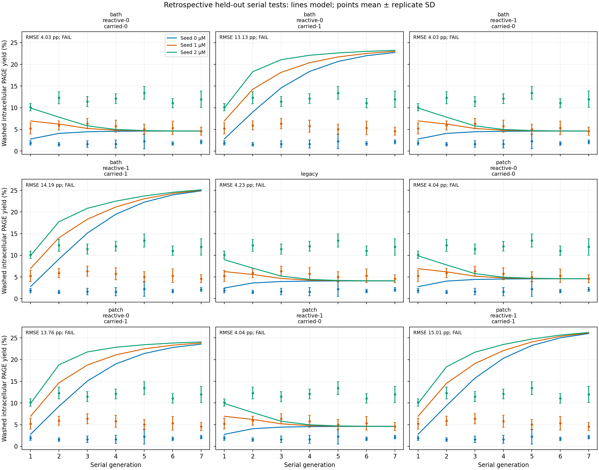

# Seed dependence survives poorly even with explicit extracellular transport

The investigation identified an unsupported irreversible-loss assumption and replaced it with conservative extracellular exchange, reaction and re-entry. **The new transport models still fail held-out validation and predict worse overall than the retained legacy comparator.** Every failure is preserved. The result is a better specified transport experiment, not a validated physical model.

The decisive source distinction is that washing prepares collected PAGE aliquots; the continuing serial culture is not documented as washed at every generation. The earlier implementation correctly used initial-only F1 and half-volume substrate feeding, but those correct schedule elements did not establish permanent removal of all RNA that escaped a vesicle. [Salibi et al., article and supplement](https://doi.org/10.1038/s41467-023-36940-z); [source interpretation and exact retained locations](diagnosis/source_interpretation.json).

## Which assumptions erase seed dependence?

The [fixed-parameter diagnosis](diagnosis/REPORT.md) retains twelve interventions for two previous chemistry families, with three initial seed doses each.

- **Repeated withdrawal plus irreversible escape strongly contracts catalyst differences.** In the old model, half transfer and 55% retention multiply a competent-catalyst difference by 0.275 each later generation. Chemistry then multiplies that remaining difference by approximately 0.25–0.66 on the observed model trajectories. A reaction-stage gain above 3.636 would be needed just to offset those event losses. These are finite trajectory contrasts, not a universal reproduction number or stability proof.
- **Irreversible competence loss accelerates forgetting but does not explain the whole failure.** Removing it raises the G7 seed-2 minus seed-0 reporter difference only to 0.095–0.356 percentage points. Removing cargo loss alone also fails and can slightly invert the contrast. The measured difference is 9.828 points.
- **Global averaging removes local catalyst–substrate correlations.** Each mixing operation contracts cohort deviations toward a population mean. That matters for nonlinear chemistry, but it is distinct from directly contracting the mean difference between separately seeded experiments. Complete mixing and stopping mixing after G1 both fail the earlier diagnostic.
- **Fresh substrates and background reactions drive similar later states under this chemistry.** Removing background pathways alone does not preserve enough seed-driven production. The finite-bath results below show that simply retaining more material can increase common background production without preserving the observed seed separation.
- **A reporter ratio can retain history after synthesis has nearly stopped.** Replacing fresh substrate with empty volume retains an 8.21–14.68-point G7 difference, while new G7 reporter production falls to approximately 1.8e-10–4.1e-11 µM. That apparent rescue is carried product in a shrinking denominator and contradicts the actual feed schedule.

The diagnosis is an explanation of model behavior. It does not uniquely identify why the physical experiment maintains seed differences.

## What was built and frozen

[model.py](model.py) keeps the earlier selected six-species chemistry and all six fitted reaction parameters unchanged. It compares:

1. **Legacy:** global mean mixing followed by irreversible uniform loss.
2. **Finite common bath:** inside and outside RNA exchange across transiently open membranes; escaped material remains available for subsequent reaction and re-entry.
3. **Effective exterior patches:** finite exchange between local exterior patches, with explicit intracellular cohorts and a conservative mixing limit. This does not predict physical diffusion distances.

The finite models conserve internal plus external RNA inventories. They distinguish half-suspension transfer, fresh substrate addition, exterior dilution, warm reaction and PAGE observation. A passive competent-founder tag separates surviving initial catalyst from newly generated competent F1. Every generation records new reporter production, reporter denominator and inside/outside inventories.

The [protocol](PROTOCOL.md) froze three families and nine scenarios before measured fitting: legacy, and both finite models under reactive/inert exterior crossed with carried/discarded exterior. Primary predictions carry and react extracellular RNA. Inert exterior freezes all chemical changes, including competence loss; discard removes the whole exterior after measurement. Neither sensitivity was selected using held-out performance.

Important approximations remain: equal internal volume per suspension volume; a constant unmeasured exterior/interior volume ratio; equal permeability for all RNA; no reaction during FT; homogenized exterior before warm incubation; and closed warm membranes. Permeability is tied to the approximate 55% initial retention through a nonreacting-tracer equation. That equation is a parameter-reduction assumption, not a measured tracer experiment. Applying sucrose-calibrated rates to the glucose exterior is also unmeasured. [Full condition and assumption ledger](research/sources.json).

## Held-out results

Calibration uses 18 Figure 2 measurements representing six conditions: initial seed 0/1 µM and one/two/three FT cycles. Evaluation uses nine Figure 2 seed-2 measurements plus all 63 positive-generation Figure 3 measurements. No held-out value enters these fits or profiles. All observations were previously inspected, so this is **retrospective held-out validation**, not prospective replication.

RMSE below uses the 72 individual held-out measurements. Maximum error uses the 24 condition means. The frozen screen requires RMSE ≤2 pp, maximum condition-mean error ≤4 pp, and computational qualification.

| Model/scenario | Calibration RMSE, pp | Held-out RMSE, pp | Maximum condition-mean error, pp | G7 seed 2−0, pp | Screen |
|---|---:|---:|---:|---:|---|
| Legacy | 1.414 | 4.479 | 9.207 | 0.0083 | FAIL |
| Bath: reactive, carried — primary | 2.252 | 13.564 | 22.738 | 0.2448 | FAIL |
| Patch: reactive, carried — primary | 2.297 | 14.331 | 23.876 | 0.2504 | FAIL |
| Bath: inert, carried | 2.252 | 12.595 | 20.602 | 0.4941 | FAIL |
| Patch: inert, carried | 2.297 | 13.178 | 21.435 | 0.5058 | FAIL |
| Bath: reactive, discarded | 2.252 | 4.701 | 9.885 | 0.0089 | FAIL |
| Bath: inert, discarded | 2.252 | 4.701 | 9.885 | 0.0089 | FAIL |
| Patch: reactive, discarded | 2.297 | 4.729 | 9.964 | 0.0089 | FAIL |
| Patch: inert, discarded | 2.297 | 4.729 | 9.964 | 0.0089 | FAIL |

The observed G7 contrast is **9.8283 pp**. The greatest predicted contrast among all nine scenarios is only **0.5058 pp**, approximately 5.1% of it. Discarded reactive/inert cases agree because exterior products cannot re-enter after that pool is discarded; those duplicate outcomes remain explicitly retained.

For the three primary/comparator models, seed-2 Figure 2 RMSE is 5.922, 7.943 and 8.054 pp, respectively. Serial-only RMSE is 4.233, 14.186 and 15.015 pp. Even the discarded-bath serial improvement to 4.030 pp does not meet the screen and worsens the combined holdout score. [All metrics](results-v1/scenarios.json), [individual predictions](results-v1/predictions.csv), [seed contrasts](results-v1/seed_contrasts.csv).

## Why carrying the exterior makes prediction worse

With reactive exterior carryover, the finite models predict G7 yields near 25–26% for every initial seed. Observed G7 means remain near 2.13%, 4.59% and 11.96%. The models create substantial common activity and gradually converge. The exterior increases material availability and prolongs some seed influence, but it does not reproduce the distinct measured late states.

The common-bath seed-2 path at G7 contains 0.06163 µM competent F1 internally and 0.06288 µM externally, expressed per unit total internal volume. It produces 0.08888 µM new intracellular reporter during G7, compared with 0.01413 µM in the legacy model. Thus the high yield is accompanied by new synthesis under the supplied chemistry; it is not solely a vanishing-denominator artifact. However, the common-bath competent-F1 contrast between seed 2 and seed 0 is slightly negative (−0.000225 µM), despite the positive reporter-ratio contrast. Reporter history and current competent inventory still differ.

Freezing exterior chemistry lowers the prediction somewhat and approximately doubles the small G7 seed contrast, yet both carried-exterior cases still fail badly. Discarding exterior recreates rapid seed forgetting. These outcomes reject this particular coupled parameterization as an adequate explanation; they do not show that real extracellular RNA is absent or that finite transport is physically wrong.

## Calibration and identifiability limits

All 126 optimization starts terminated successfully; all 21 optimized fits had at least two agreeing starts. Nine additional bath profile points were direct objectives. Successful convergence is separate from chemical adequacy.

The fitted legacy mixing fraction is 0.037239. The bath volume ratio is 2.35698. Patch fitting gives ν=2.25421 and exchange=10, the frozen upper boundary. Within this closure and these calibration rows, slower local exchange is not preferred; the fit moves toward the common-bath limit. Bounds were not expanded after seeing this outcome.

The nine-point training-only profiles are preserved. For patch diffusion, profiled SSE decreases from 275.35 at .001 to 94.95 at 10, while fitted ν changes along with it. The ratio and exchange rate are conditional effective parameters, not measured physical geometry. The common bath's minimum SSE is 91.30, compared with legacy 35.99. Extra transport structure therefore does not improve this calibration either. [All starts and profiles](results-v1/profiles.json); [profile figure](results-v1/training_profiles.pdf).

## Additional primary evidence and what could constrain the next model

The [source review](research/REPORT.md) uses Peter and Schwille's local interface exchange and Litschel et al.'s density-dependent cargo exchange as physical constraints. Their tracer studies support transient permeability and finite local transport, but do not measure active F1 survival or a universal exchange radius. [Peter and Schwille, 2023](https://doi.org/10.1002/syst.202300008); [Litschel et al., 2018](https://doi.org/10.1088/1367-2630/aabb96).

The newly acquired [Tsuji et al., 2026 dataset](https://doi.org/10.1038/s42003-026-10218-8) includes seven workbook sheets and 228 source rows, with mixing-ratio and feed-withdrawal comparisons. It uses a 2041-nt template, externally supplied Qβ protein replicase, DMSO-assisted fusion, different incubation conditions and explicit exterior replacement. Its serial experiment has one starting RNA dose and storage interruptions. These observations can challenge assumptions about feeding and exchange, but cannot calibrate Salibi's ligase chemistry, test multi-dose seed memory, or establish autonomous catalyst inheritance. The workbook lacks replicate identifiers for the serial rows; no independent trajectory identities were invented. [Dataset inventory](research/dataset_inventory.json).

The next useful evidence is paired inside/outside measurements at each FT, warm and transfer stage: precursor/full-length RNA quantities, native and recovered catalytic activity, actual compartment/exterior volumes, and catalyst–substrate co-localization. In particular, separate loss from vesicles from loss from the continuing culture, and separate productive inter-vesicle transfer from dilution into inaccessible exterior. Founder/new-product labels plus a competence assay are needed to distinguish passive survival from regenerated active catalyst. These are measurement priorities, not newly fitted mechanisms or performed experiments.

## Reproducibility and evidence preservation

- 35 unit/invariant/validation tests pass. Synthetic recovery gives prediction RMSE below 1.3e-12 pp for all three families.
- Independent full coupled ODE verification passes 600 checks, 2,688 transport quantities and 19,440 short-serial quantities across 24 paths. Maximum discrepancies are 8.38e-13 µM for transport, 1.52e-9 µM for serial inventories and 9.62e-8 pp for PAGE.
- The official run completed all 30 saved fit/objective files, 810 predictions, 216 trajectory rows, 840 stage rows and 144 seed-contrast rows. Refined predictions and state ledgers are also retained. All nine accuracy screens fail; all nine numerical checks pass.
- Tightening the chemistry tolerance changes PAGE by at most 2.14e-7 pp. Maximum source/removal moiety residual is 1.34e-14 µM. All 473 prior/source files audited by the runner remain unchanged.
- A complete separate fresh-process refit completed in `verification-v1/`. Independent comparison found all 44 scientific output files and 46 common frozen input files identical, after excluding clocks. The archives are **not byte-identical**: the second snapshot also includes five ancillary independent-verification documents/copies finalized between freezes. The strict snapshot-parity failure is retained and reconciled separately; no numerical result or executed model changed. [Qualified scientific-equivalence receipt](independent/campaign-v2/verification.json), [retained strict archive failure](independent/campaign-v1/verification.json), and [checks.md](checks.md).

[Reproduction commands](README.md), [frozen run manifest](results-v1/freeze.json), [official outputs](results-v1/summary.json), [independent numerical report](independent/REPORT.md), [work requirements](WORKPLAN.md).

No physical experiments, author contact or publication occurred. Active-catalyst retention, functional inheritance and the actual mechanism maintaining seed dependence remain unresolved.
