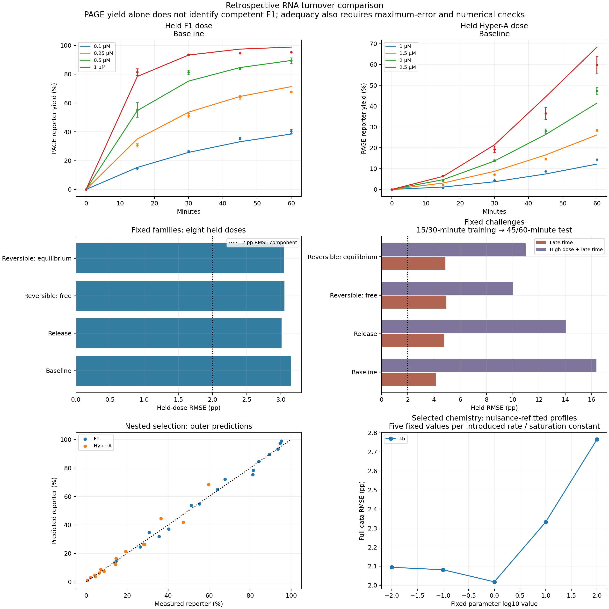
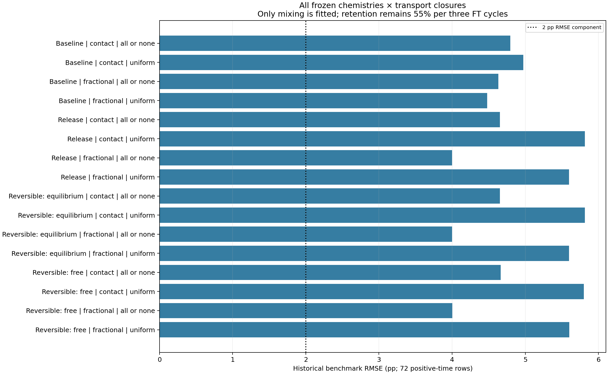

# Remaining RNA failures: finite turnover and transport

The chemistry revision improves one average prediction score but does not resolve the high-dose, late-time or transport failures. All four candidates fail whole-dose prediction, late-time prediction and the combined high-dose/late-time challenge. All sixteen transport scenarios fail. The registered simplicity rule retains the earlier baseline, which also remains inadequate.

Both frozen numerical campaigns are complete and independently verified. Saved-parameter replay and the complete fresh-process refit agree. Earlier laboratories and negative outcomes remain intact.

## What the earlier failure actually showed

The previous six-parameter model joined separate active/reporter efficiencies with a common loss of catalyst competence. It improved F1 whole-dose prediction from 4.297 to 2.707 percentage points (pp) RMSE but worsened Hyper-A prediction from 2.599 to 3.529 pp. The omitted 2.5 µM Hyper-A curve accounted for 44.6% of its total held-dose squared error. Its errors at 45/60 minutes were +7.879/+8.639 pp. Omitting the neighboring 2 µM curve instead underpredicted its endpoint by 5.947 pp.

The early-only fit showed a different failure: seeded-F1 late predictions were too high on average, while Hyper-A late predictions were too low. Active ligation and B saturation moved to their lower bounds despite agreement among all six optimizer starts. Thus a single global slowdown is not a sufficient explanation. The endpoint inaccuracy is not simply an integration failure: an independently written DOP853 replay differed from the earlier predictions by at most 0.0000711 pp. Full diagnostics, source checks and residuals are retained in [diagnosis/REPORT.md](diagnosis/REPORT.md).

The transport audit found no error in the audited schedule, source extraction or dilution arithmetic. Its principal structural failure was loss of seed dependence. At generation seven the previous models converged near 3.18–4.12% reporter yield across seeds, while measured means remained 2.13%, 4.59% and 11.96%. The seed-2 observations contributed roughly 90–93% of transport benchmark squared error. Nominally equivalent first-cycle observations in separate assays also disagreed; this preparation/assay variation is retained, not averaged away. See [transport_diagnosis/REPORT.md](transport_diagnosis/REPORT.md).

These findings expose predictive inadequacy and conflicting effective-parameter estimates. Missing model structure and unmodeled assay variation remain possible explanations. They do not prove that RNA self-replication itself failed or that one microscopic mechanism caused the residuals.

## Chemistry tested

The revision makes catalyst occupancy explicit. An F1-mediated active ligation produces an F1–F1 complex; reporter ligation produces an F1–reporter complex. Both require a finite release event before their competent strands become available to catalyze another event. Reversible variants also allow full-length strands to bind again. Related ligase studies support this topology, while their different sequences, temperatures, magnesium and reporter chemistry prevent importing their numerical constants as Salibi measurements. [Ferretti and Joyce, 2013](https://doi.org/10.1021/bi301646n); [Olea and Joyce, 2016](https://doi.org/10.3390/molecules21101310).

The twelve-state implementation tracks three precursor species, free competent F1, inactive full-length RNA, ligated inactive reporter, and six pair complexes. A common competence-loss hazard acts on each competent strand, including those in complexes; loss neither automatically protects a bound catalyst nor forces complex release. The no-regeneration control sends newly ligated active-origin material into inactive states. Three independent RNA-moiety balances are conserved.

The denaturing-PAGE observer counts every covalently ligated fluorescent strand, including those held in complexes. It is distinct from both free catalyst and total competent full-length RNA. This follows the source assay's denaturing analysis and reporter mutation. [Salibi et al., 2023](https://doi.org/10.1038/s41467-023-36940-z).

Four fixed candidates were registered: the previous instantaneous six-parameter baseline, finite release with seven parameters, and reversible binding with eight parameters under initially free or equilibrated preparation. Shared affinities across competent, inactive and reporter strands remain unmeasured assumptions. Precursor-assisted initiation retains its effective rate laws. Pyrophosphate, folding intermediates and microscopic thermodynamics are not dynamically modeled. The revision is a more explicit chemical hypothesis, not a complete molecular mechanism. Exact reactions, units, parameter bounds and statistical factors are in [PROTOCOL.md](PROTOCOL.md) and the [source review](research/REPORT.md).

## Whole-dose prediction

All four fixed-family dose comparisons resolved. Scores exclude time zero and cover 32 held-out positive-time means. Errors are in percentage points:

| Chemistry | Full-data RMSE | Whole-dose RMSE | Largest held-dose error | Adequacy screen |
|---|---:|---:|---:|---|
| Instantaneous baseline | 2.014 | 3.145 | 8.639 | Fail |
| Finite release | 1.930 | 3.012 | 7.466 | Fail |
| Rebinding, initially free | 1.930 | 3.052 | 7.466 | Fail |
| Rebinding, initially equilibrated | 1.930 | 3.046 | 7.466 | Fail |

Finite release reduces ordinary held-dose RMSE by 0.133 pp, approximately 4.2%, but remains outside both registered error limits. Rebinding does not improve this score over release-only. The previous baseline is within 0.25 pp of the lowest RMSE, so the registered simplicity rule retains its six-parameter family. That is a selection decision, not an adequacy verdict. Training improvement alone would give an overly favorable impression of the revision.

The improvement remains uneven: release-only lowers Hyper-A held-dose RMSE from 3.529 to 3.156 pp while increasing F1 error from 2.707 to 2.861 pp. Its omitted 2.5 µM Hyper-A predictions still exceed the measured 45/60-minute values by 7.003/7.466 pp. Both binding variants give almost the same high-dose errors. Explicit turnover therefore softens the high-dose failure without resolving the conflict between branches.

Nested selection produces RMSE 3.226 pp and maximum error 8.639 pp, also failing the screen. It chooses baseline in five outer folds and release in three (F1=0.1, F1=0.25 and Hyper-A=2 µM). Each outer dose is excluded from both inner family selection and parameter fitting. This evaluates the selection procedure; the release-only ordinary score above is not an independently validated score for a selected winner.

## Late-time and combined extrapolation

Each family is refitted to the registered early observations. These results are separate challenges, with no selection from their outcomes. All values below are percentage points; every row fails both error limits.

| Chemistry | Late-time RMSE | Late-time maximum error | High-dose + late-time RMSE | High-dose + late-time maximum error |
|---|---:|---:|---:|---:|
| Instantaneous baseline | 4.148 | 8.220 | 16.380 | 26.644 |
| Finite release | 4.773 | 9.069 | 14.067 | 23.392 |
| Rebinding, initially free | 4.937 | 10.836 | 10.036 | 16.174 |
| Rebinding, initially equilibrated | 4.865 | 9.539 | 10.985 | 17.963 |

Finite turnover and rebinding improve the severe combined challenge but worsen late-time prediction across the observed doses. In the latter, every candidate overpredicts F1 on average and underpredicts Hyper-A: branch biases range from +3.66 to +4.69 pp and −2.75 to −3.65 pp, respectively. Removing the highest doses as well reverses the Hyper-A error: its 60-minute endpoint is overpredicted by 16.17–26.64 pp. This dependence on which observations are available is evidence of poor extrapolation, not a stable chemical explanation.

All four early-only fits place `ka` at or very near its lower bound. The initially free binding fit changes `kd` from approximately 0.0125/min in the full fit to 0.000776/min and `kbind` from 0.00752 to 3.79 µM⁻¹ min⁻¹. Such parameter shifts, despite successful numerical fitting, make microscopic interpretation unreliable.

The equilibrated candidate's combined-challenge fit has one start at the chosen training SSE of 7.486, while five starts converge near 9.677. It is resolved under the registered rule but carries the retained start-agreement flag. No selective retry or extra budget was used. Its reported prediction is conditional on the chosen successful start.

## Transport outcomes

All sixteen scenarios resolve numerically and fail the historical benchmark. The table gives benchmark RMSE, with maximum absolute condition-mean error in parentheses, in percentage points. The limits are 2 and 4 pp, respectively.

| Chemistry | Fractional / uniform loss | Fractional / all-or-none loss | Contact / uniform loss | Contact / all-or-none loss |
|---|---:|---:|---:|---:|
| Instantaneous baseline | 4.479 (9.207) | 4.632 (8.603) | 4.975 (10.147) | 4.797 (8.377) |
| Finite release | 5.600 (12.320) | 4.001 (7.840) | 5.814 (12.188) | 4.653 (8.034) |
| Rebinding, initially free | 5.601 (12.321) | 4.005 (7.847) | 5.801 (12.159) | 4.663 (8.060) |
| Rebinding, initially equilibrated | 5.600 (12.320) | 4.001 (7.840) | 5.814 (12.188) | 4.653 (8.034) |

The 4.001 pp value is the lowest among these reported sensitivities, not a benchmark-selected transport model. It comes from finite release with fractional mixing and all-or-none content loss. Uniform-loss turnover models perform worse than the corresponding baseline. Thus the spatial loss assumption materially changes the outcome even with identical aggregate retention. Since bulk selection retained baseline, the protocol's additional selected-turnover complex-reset cases were not invoked; reset is identical for the instantaneous baseline.

The central transport failure survives every scenario: at generation seven the largest predicted spread across seeds 0/1/2 is only 0.023 pp, versus a measured mean spread of about 9.828 pp. For example, finite release with fractional mixing predicts 0.827/0.839/0.850% under uniform loss and 6.511/6.515/6.517% under all-or-none loss. The measured means are 2.133/4.591/11.961%. Changing the loss distribution shifts the common endpoint level but does not preserve the observed dependence on initial seed.

The seed-2 share of benchmark squared error falls from 90.0% for baseline fractional/uniform transport to 65.1% for release fractional/all-or-none transport, while large errors remain. This redistributes the failure; it does not establish active retention or inheritance. Frozen trajectories retain free, bound, total competent and conditional founder inventories separately in [transport_trajectories.json](results-v1/transport_trajectories.json).

## Restrictions the revision still imposes

Let L be all ligated reporter strands, and C all competent full-length strands, whether free or bound. Summing the implemented reactions gives `dL/dt=vr+vp` and `dC/dt=va+vh−kd C`. Binding and release cancel from these balances. Therefore, when Hyper-A is absent, every candidate imposes the exact identity `C(t)=F0 exp(−kd t)`, with `R=5−L` and `B=7.5−L`. Occupancy changes free F but cannot protect or restore total competence under this frozen uniform-loss assumption. An improved reporter prediction would not validate that identity experimentally.

For release-only chemistry in these F1-only reactions, write `g(L)=(5−L)(7.5−L)/(KB+7.5−L)` and `z=QFP/C`. Then `dL/dt=kf F0 exp(−kd t)(1−z)g(L)` and `dz/dt=kf g(L)(1−z)−krel z`. Finite occupancy breaks the earlier transformed-exposure equality, but retains an upper bound: the integral of `1/g(L)` from zero to the observed L cannot exceed `kf F0[1−exp(−kd t)]/kd` (continuous zero-loss limit `kf F0 t`). These are algebraic properties of the model, not additional measured constraints.

There is a stronger release-only identity. Define `H(L)=log[5/(5−L)]+(KB/2.5){log[5/(5−L)]−log[7.5/(7.5−L)]}`, `E(t)=[1−exp(−kd t)]/kd` and `d=krel+kd`. Then `H(L)/kf+L/d=F0 E(t)+QFP/d`. Since `0≤QFP≤F0 exp(−kd t)`, the transformed curve divided by F0 lies between `E(t)` and `E(t)+exp(−kd t)/d`. For the completed release full fit, that permitted envelope width is 5.29%, 2.40%, 1.45% and 0.98% of E at 15/30/45/60 minutes. This quantifies a remaining near-collapse restriction; those percentages are not PAGE errors or held-out scores. A numerical check of the identity across four F1 doses is retained in [structural-identities.json](structural-identities.json), with maximum residual 1.42e-8 µM·min. It does not apply to the rebinding candidates.

The fixed initial B concentration also permits parameter tradeoffs. When `KB` is much larger than B, the rate laws mainly identify `kf/KB`, `ka/KB`, `kh/KB²` and `krh/KB²`. Scaling KB and the corresponding rate constants together approximately preserves the reaction rates. This is a limiting approximation, not exact global non-identifiability: substrate depletion can provide some KB information. Bound estimates and broad objective profiles must therefore be reported without promoting a fitted KB or release coefficient to a microscopic measurement.

The completed full-data fits illustrate the distinction between reporter and catalyst. At 2.5 µM initial Hyper-A and 60 minutes, the model states are:

| Full-data fit | PAGE yield (%) | Competent strands (µM) | Free competent F1 (µM) | Pair complexes (µM) |
|---|---:|---:|---:|---:|
| Instantaneous baseline | 60.323 | 0.2661 | 0.2661 | 0 |
| Finite release | 60.628 | 0.3073 | 0.2370 | 0.0627 |
| Rebinding, initially free | 60.636 | 0.3080 | 0.2301 | 0.0999 |
| Rebinding, initially equilibrated | 60.628 | 0.3073 | 0.2370 | 0.0627 |

These are fitted latent-state predictions, not measured active concentrations. Their closely matching reporter yields do not resolve the catalyst allocation. The equilibrated candidate drives binding to its lower bound, while all three turnover fits put `KB` at its upper bound of 100 µM. Their full-fit agreement therefore supplies no evidence that reversible sequestration has been identified. The unrounded states and parameters are retained in [reduction-verification.json](reduction-verification.json) and the individual full-fit receipts.

## Validation and evidence boundaries

All measurements were inspected in earlier rounds. The comparison is retrospective, although each held-out observation is excluded from its corresponding parameter fit. Eight whole-dose folds evaluate fixed families; nested selection keeps each outer dose out of family selection. Separate fits use 15/30-minute observations to predict 45/60 minutes. The combined challenge removes F1=1 µM and Hyper-A=2.5 µM entirely, trains on twelve early observations at six other doses, and predicts four high-dose late-time observations.

Only the 32 positive-time S13 means count in the primary ordinary score; time-zero points cannot improve it. Candidate selection uses the registered 0.25 pp simplicity rule. Every fit retains the same six starts and 160-function-evaluation budget per start. Unsuccessful finite starts are preserved and cannot resolve a fit. Full-fit refinement and conservation checks qualify adequacy; this is not tolerance certification of every optimization evaluation or fold.

The pragmatic acceptance screen remains RMSE≤2 pp and maximum absolute error≤4 pp. Published n=3 summary data do not establish the replicate covariance needed for calibrated likelihood intervals or a mechanistic hypothesis test. Five-point nuisance-refitted profiles expose sensitivity, not confidence intervals.

An independently written five-state reduction checks the bulk chemistry with DOP853 against the twelve-state LSODA implementation. It tracks total ligated reporter, full-length RNA, competent strands, free F1 and pair complexes, deriving the precursor concentrations from conservation. Across all four completed full fits and five synthetic cases, 1,800 observable comparisons passed. Maximum differences were 4.07e-7 pp for PAGE and 2.07e-8 µM for inventories, below the registered numerical limits. The [checker](reduction_check.py) and [raw comparisons with source hashes](reduction-verification.json) are retained. This checks bulk implementation; it does not independently implement transport or establish physical adequacy.

For transport, each chemistry is frozen from its full bulk fit. The only fitted quantity is mixing, calibrated on the same eighteen Figure 2 seed-0/seed-1 observations. Figure 2 seed 2 and all positive Figure 3 generations provide the historical 72-row benchmark. Uniform concentration loss and all-or-none content emptying share the same 55% aggregate RNA retention after three freeze/thaw cycles; they represent different unmeasured spatial distributions. Fractional/contact mixing are both retained. Instantaneous complex dissociation after each cycle is an additional fixed sensitivity only for a selected turnover family. No benchmark score selects a transport winner.

For any deterministic prediction shared by the three replicates of a condition, the lowest attainable empirical RMSE is the within-condition RMS deviation around each group mean. It is 0.502 pp for the eighteen calibration observations and 0.921 pp for the 72 benchmark observations. Thus the 2 pp screen is above this descriptive floor; replicate spread alone does not explain the predecessor's roughly 4.5–5 pp benchmark errors. This decomposition is not an estimate of population measurement noise or a calibrated significance test.

## Reproducibility and retained negatives

Each complete campaign contains 161 resolved fits and 966 successful optimizer starts: 148 dose-subset fits, eight time-challenge fits and five selected-baseline `KB` profile fits. One fit has the start-agreement flag described above. Every start, bound estimate, prediction and rejected scenario remains saved. There are no discarded unsuccessful starts in these campaigns; the failure-handling paths are covered by tests.

The selected baseline's five `KB` profile values 0.01/0.1/1/10/100 µM give nuisance-refitted RMSE 2.094/2.081/2.018/2.331/2.765 pp. These are coarse sensitivity results, not confidence limits. Because baseline was selected, no introduced release or binding parameter qualified for the registered selected-model profiles.

All four full-fit numerical checks pass: the largest tolerance-refinement difference is 3.96e-7 pp, batch/separate difference 2.64e-6 pp and RNA-moiety error 1.60e-14 µM. All 48 transport refinement checks pass, with maximum difference 9.12e-8 pp and moiety error 1.45e-14 µM. These checks are much smaller than the measured prediction errors.

The 50-test suite passes. [Saved-parameter replay](saved-parameter-replay.json) checks 161 fits, 3,288 predictions and 264 split records; predictions reproduce exactly and the maximum training-SSE difference is 2.85e-14. The independently written bulk solver check is described above. The official campaign took about 93 minutes on this host, with four fitting processes; no timing guarantee is implied for other machines.

The [independent verifier](independent-verification.json) reconstructs scoring, family selection, split membership, fitting records, profiles, state inventories and transport accounting. It also replays the saved model, including each finite optimizer-start objective. Its 53,451 numeric replay/arithmetic comparisons have maximum absolute difference 2.84e-14. The fresh-process refit matches all 63,917 compared scientific numbers across 193 files exactly, with identical discrete choices and row IDs. Clock fields and plot bytes are excluded. Both 232-file manifests and 36 frozen inputs pass; all 268 audited previous-laboratory hashes remain unchanged. This establishes computational reproducibility, not a uniquely identified physical mechanism. The [independent review receipt](../.omo/evidence/rna-turnover-tests-review.md) records the final code and evidence assessment.

Raw results and source snapshots are in [results-v1](results-v1/summary.json), with the entire fresh-process refit in [verification-v1](verification-v1/summary.json). [README.md](README.md) gives pinned offline commands. Both result directories refuse reuse and retain manifests. The [verification checklist](checks.md) separates software reproducibility from physical adequacy.

## What the existing data can constrain

The literature search found no new numerical holdout matching this assay's enzyme, reporter, temperature and buffer. Older release, binding and stability experiments constrain plausible reaction topology and offer condition-specific comparisons. They do not identify active F1 retention under this freeze/thaw protocol. Existing source data remain publicly traceable through the [source ledger](research/sources.json); retrieval failures and incompatible conditions are recorded.

The [earlier dataset investigation](../rna-mechanism-2026-10-15/REPORT.md#new-public-datasets-and-what-they-constrain) and [inheritance study](../rna-inheritance-design-2026-10-15/REPORT.md) remain available with their original raw records and qualification gaps. This round neither relabels those datasets as newly acquired nor pools their different organisms, chemistry and observers into the F1 calibration.

The most discriminating next data would pair denaturing full-length measurements with an independent activity measurement, before and after transport, under the same reaction conditions. Product-spike or pulse-chase measurements would separate turnover/rebinding from irreversible competence loss. Independently varying initial B would test the saturation/rate tradeoff. Early samples matter: the release full fit implies an initial occupancy-relaxation time of about 0.44 minutes, whereas S13's first nonzero sample is at 15 minutes. This is a conditional model timescale, not a measured release lifetime. Spatial content distributions would distinguish uniform leakage from heterogeneous emptying. Parent–daughter activity and subsequent new synthesis would be needed to test functional inheritance. These are measurement requirements, not experiments conducted here.

Reporter persistence alone cannot establish retained catalytic competence, self-maintenance, functional inheritance, life or intelligence. Conditional founder bookkeeping is a model calculation; it is not a measured molecular lineage.
