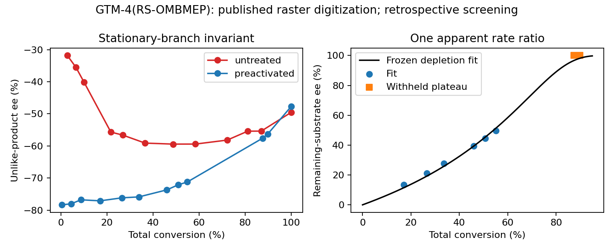

# Complementary function improves; functional inheritance remains unmeasured

The documented PMo12 scaffold remains provisional. This follow-up acquired new primary GTM/STW evidence and tested an existing catalyst's reaction behavior. It adds **zero verified integrated complements**. Neither the hypothetical Mo34WV formula nor the complete life/intelligence goal is validated.

## What the source follow-up changes

The [GTM findings](GTM3_FINDINGS.md) improve structural identity and expose a useful but carbon-dependent activation comparator. The 2024 study's majority-handedness counts are 13/15 and 10/13 crystals: approximately 82% majority enrichment must not be called 82% crystal ee. Independently prepared catalysts still use externally supplied chiral organic directing agents. [Primary study](https://doi.org/10.1021/acsami.4c14487).

The 2025 GTM study distinguishes butanol coordination, humidity protection and dehydrated butoxide formation. GTM-4's preactivated selectivity is stronger than GTM-3's; their values cannot be interchanged. The humidity experiment preserves XRD through 168 h after 50 C loading, with a separate 115 C preparation. It does not measure post-humidity catalytic activity or survival in acidic aqueous PMo12. Catalytic preactivation is room-temperature overnight treatment; 120 C treatment is reported inactive without quantitative rate or detection limit. Butanol remains a functional organic ligand/reactant, so this is a mechanistic comparator for our noncarbon objective. [Primary study and open SI](https://doi.org/10.1021/jacs.5c12567).

The [STW findings](STW_FINDINGS.md) retain an important negative: high framework handedness does not ensure accessible catalysis. The 2024 source's Al-STW assay gives only 2–6% conversion and at most 4% tabulated product ee. Its SI table and prose conflict; different composition and crystal sizes also confound the uptake comparison. Cross-paper R/S labels even reverse for the same space group. No diffusion coefficient or pooled chirality-transfer parameter is fitted. [Primary study](https://doi.org/10.1038/s41467-024-49659-2).

No acquired follow-up maps useful catalytic function to newly grown, cue-free descendants with independently bounded founder activity. This bounded search is not proof that such inheritance is impossible. The inaccessible Catalysis Today full text and Kang main paper remain explicit access limits. The earlier parent-priority/cue-priority witnesses therefore remain unresolved; independent-batch catalyst assays do not fill their missing offspring matrix.

## Executed chemistry model

[The protocol](PROTOCOL.md) was frozen before numerical extraction/fitting, after the source figure and author outcomes had already been seen. This is a **retrospective withheld-point assessment**. The native raster yielded 45 retained marker centers in panels A/B. Four legends were excluded. Two partially overlapped red markers required circle fits to their visible red arcs; the initial 43-marker extraction remains saved. Some overlapping near-origin/plateau substrate markers were not recovered and were not imputed. No blue fit-region marker is missing. Pixel geometry, method and conservative analyst coordinate allowance are recorded in [data/extraction.json](data/extraction.json).

The numerical assay is specifically **GTM-4(RS-OMBMEP)**, not GTM-3. For initially racemic substrate pools, the irreversible depletion null is

`F=0.5*u^s`, `S=0.5*u`, `x=1-F-S`, `ee_sub=(S-F)/(S+F)`.

Eliminating `u` by bisection fits a dimensionless total-rate ratio `s`; no clock-time rate or transport constant is identified. Six preactivated substrate points at 10–60% conversion give **s=3.93837**, training RMSE **1.56019 percentage points**. Two withheld points at approximately 87%/90% conversion give predictions 96.71%/98.22% ee against the resolution-limited approximately 100% plateau. Withheld RMSE is **2.74725 percentage points**, below the frozen 5-point screen; largest residual is 3.39482 points.

This pass is narrow. The two withheld observations share one plateau; small residual concentration makes ee fragile. The raster's 100.107% ee is preserved as artwork and not interpreted as physical excess or exact purity. Coherent +/-2-point coordinate shifts move the fitted apparent ratio from **3.33471 to 4.77627** and the combined withheld prediction range from 90.37% to 99.79%. These are sensitivity scenarios, not confidence intervals or a proof that every digitization realization passes. Replicate uncertainty and raw chromatograms are absent.

The stationary branching null fails independently. With fixed nonnegative coefficients, `U1=a*C_F+b*C_S` and `U2=d*C_F+e*C_S`, product ee is a fractional-linear function of the monotonically changing `C_F/C_S`; it cannot turn. The untreated unlike-product sequence approximately **-31.77 -> -59.43 -> -49.52%** has a turning excursion of 9.907 points, retaining **5.907 points** after the declared coordinate allowance. The preactivated series does not show a resolved turn. This rejects the particular stationary two-pool/constant-branch model for untreated material. It does not uniquely select activation over concentration effects, changing adsorption/transport or secondary chemistry.

[Machine-readable results](results/activation.json) retain residuals, sensitivity and limitations. Self-checks pass for positivity, material balance, equal rates, label exchange, synthetic parameter recovery and invariant examples.

## Better chemical model and its current limit

A defensible extension separates initial/hydrogen-bonded sites, butanol-coordinated active sites, dehydrated butoxide sites and hydrolyzed framework. It couples ligand occupancy to product branching and water exposure to structural loss. The source's spectroscopic and thermal observations constrain which states exist; they do not supply transferable interconversion, water-transport or repair rates. Consequently this extension is **proposed, not numerically validated**. No arbitrary rates were inserted to make the failed stationary model pass. Cluster DFT energies were not promoted to solution populations or observed rate constants.

For the original goal, the new evidence changes candidate selection: retain useful inorganic framework chirality as component evidence, reject the assumption that purity or XRD stability guarantees function, and keep active organic ligation explicit. R/H/V/J remain unresolved. A decisive inheritance measurement still requires opposing seed states under the same achiral feed, attribution of function to new material, a bound on founder catalytic contribution, and serial transfers. Neither this reaction fit nor an additional unconstrained inheritance simulation can supply that observation.
