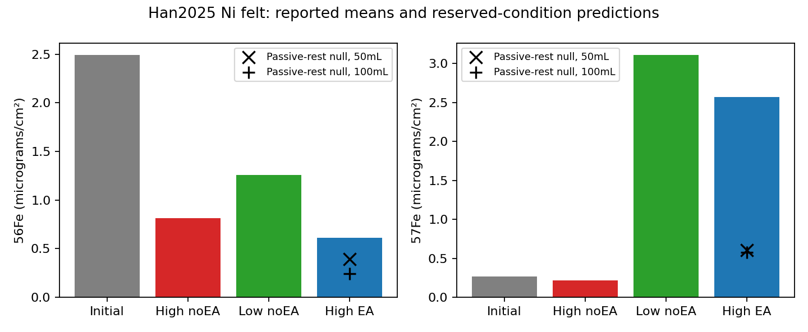

# New isotope evidence improves the repair candidate; inheritance remains unresolved

The candidate selected for a quantitative test is Fe-incorporating **nickel felt**, Bekaert2Ni18-025, operated with intermittent reductive activation in alkaline electrolyte. Its isotope-switch experiment distinguishes incoming Fe from the initial measured Fe stock. It is a better material-replacement comparator than total-metal retention or diffraction survival. No verified integrated complement or living/intelligent entity is added.

## Dataset search and actual Opus consultation

The user-authorized Claude desktop conversation was inspected with **Opus5.5 Max** selected. The question was submitted in three paragraphs; the app treated typed newlines as separate messages, and the queued context was explicitly delivered using “Send now.” A paste attempt had first inserted an old clipboard answer into the unsent composer; it was replaced before submission. `consultation/prompt.txt` preserves the intended combined question. The actual activity showed primary searches on dynamic Fe sites, acidic oxide repair and repeated MAX-phase crack healing. The app then displayed its usage cap before delivering an answer. That interruption remains in `consultation/usage-limit-state.txt` and `usage-limit.png`.

After the displayed2:20PM local reset, a short synthesis request produced a completed answer. [The actual response](consultation/response.txt), [visual proof](consultation/completed-opus.png) and [independent claim audit](consultation/AUDIT.md) are saved. Opus supports keeping Han as a material-replacement comparator and MAX-phase oxides as repair precedents, while rejecting an inheritance claim. It explicitly did not examine Han or Poli itself. Its advice is distinguished from the separately acquired primary evidence; overbroad exclusivity, isolated-filler-function and universal potentiostatic wording are not adopted. No numeric fit was changed after this answer.

Independent primary searches and native acquisition proceeded while that consultation ran:

- [Han2025, DOI10.1038/s41467-025-60201-w](https://doi.org/10.1038/s41467-025-60201-w): main article,47-page SI, peer-review file, native42-sheet source workbook and Figure3. Its57Fe switch makes it the selected replacement comparator. [Repair source audit](REPAIR_LEADS.md).
- [Poli2025, DOI10.1039/D5GC00114E](https://doi.org/10.1039/D5GC00114E): the previously blocked [raw deposit](https://doi.org/10.34894/XW7RK6) now exposes638 catalogue entries. The acquired481-file electrochemical subset is55.24MB and matches repository checksums. Historical403/Anubis failures remain unchanged. Electrode normalization, reference potential and omitted pulse segments need care before a separate raw-trace analysis; no such fit is claimed here.
- [Eu-doped TbPO4 chirality, DOI10.1002/chir.23523](https://doi.org/10.1002/chir.23523): new timed luminescence/CPL data compare opposing seed injection against the organic growth cue. Founder photon contribution and serial descendant function remain unbounded. [Inheritance source audit](INHERITANCE_LEADS.md).
- [Seed-assisted ZSM-5, DOI10.3390/nano12091601](https://doi.org/10.3390/nano12091601): useful new catalyst/adsorption function after seed-assisted formation, without inherited functional variants. No H credit.

Claude's actual search activity also surfaced two primary MAX-phase repair papers, subsequently acquired and checked independently: [Sloof2016](https://doi.org/10.1038/srep23040) and [Osada2020](https://doi.org/10.1038/s41598-020-75552-1). Their Ti2AlC host supplies Al that oxidizes into new load-bearing Al2O3 bridges, with some TiO2. These are chemical and mechanical repair precedents beyond redistribution of existing melt. They require external heating in air near1473–1500K; Ti2AlC contains structural carbon, and the consumed Al inventory is finite. No replenishment, descendant functional inheritance or compatible aqueous PMo12 integration is shown. Later cracks remain partly unfilled, and fourth-cycle strength/toughness decline is retained. Native SI and videos were acquired; videos were not reanalyzed and no raw force/tomography dataset was identified in those packages. [Primary audit](CLAUDE_REPAIR_LEADS.md).

## What the isotope experiment adds

Han's nickel felt is first conditioned for20h with natural Fe, then challenged for20h in purified1M KOH plus100ppb57Fe. The three continuations are high-current/no activation, low-current/no activation, and high-current/activation. The activation cycle is1h at0.5A/cm2 followed by3min at a reported0.6V_RHE. Rinsed samples are analyzed by ICP-MS. Exact digestion/active-film isolation and isotope-standard enrichment are not specified. The independent coupon groups are not a tracked single sample.

Native Figure3g means, micrograms per geometric cm2:

| State |56Fe |57Fe | Individual sum | Source-reported sum |
|---|---:|---:|---:|---:|
| Initial conditioned felt |2.490 |0.26720 |2.75720 |2.758 |
| High current, no activation |0.814 |0.21670 |1.03070 |1.030 |
| Low current, no activation |1.259 |3.10598 |4.36498 |4.365 |
| High current, activation |0.614 |2.56700 |3.18100 |3.189 |

Subtracting **all** initial measured57Fe gives a conditional positive excess of **2.2998micrograms/cm2** in the activated group: **72.30% of its measured56+57Fe inventory**. This descriptive population comparison assumes comparable initial coupons. It is not a lower bound on catalytically active new sites, complete Fe turnover, or inherited function. The high-current/no-activation group has no positive excess by this conservative calculation.

Retain three measurement problems: the initial57/56 ratio differs from nominal natural Fe; the source sums do not exactly equal individual columns; caption SEM n=3 is not accompanied by numerical SEM or raw replicates in the isotope block. The source's isotope sentence also repeats56Fe on both sides of a comparison. Worksheet and figure identity are retained instead of silently correcting the sentence.

The paper's potential responses and Fe-depletion controls support functional electrode regeneration. They are not isolated new-material catalytic assays. Its gas-output test belongs to a separate AEM device; that efficiency is not assigned to these isotope arms. The long device test includes membrane replacement at525h. Predeposited NiFe is harmed by the same activation protocol, so the benefit does not transfer to every NiFe preparation.

## Executed finite-reservoir test and preserved failure

[The frozen protocol](PROTOCOL.md) defines a homogeneous two-compartment exchange model for each tracked isotope: `dS/dt=k_in*L-k_j*j*S`, with opposite change in the finite liquid inventory. The passive-rest null turns off OER-driven loss during the reductive pulse but grants no enhanced uptake. Only the two no-activation endpoints enter parameter fitting. The activated endpoint is reserved from fitting.

[Deviations](DEVIATIONS.md) are explicit: the exact reserved endpoint was accidentally viewed before implementation, after the split/equations/threshold were frozen. This violates the unread-endpoint instruction. The outcome is therefore **retrospective and analyst-exposed**, not blinded or fully protocol-compliant validation. Before any fit, the material name was corrected from foam to felt and natural isotope amount fractions were converted to mass fractions. Both50mL and100mL accessible-bath assumptions are reported because the source calls its two50mL compartments undivided.

| Assumed accessible bath | Control RMSE, micrograms/cm2 | Reserved activated RMSE, two clock interpretations | Result |
|---|---:|---:|---|
|50mL |0.43683 |1.39516–1.51479 | Calibration and reserved screening fail |
|100mL |0.35377 |1.43360–1.60153 | Calibration and reserved screening fail |

The declared analyst screen is0.25micrograms/cm2 maximum isotope error, not a statistical confidence test. Calibration already fails, so the reserved error cannot uniquely diagnose a missing pulse mechanism. The retained-only baseline is worse descriptively, with control/reserved RMSE1.75966/2.09863micrograms/cm2; outperforming it does not validate the exchange model.

Absolute rates remain unidentified. Multiplying both fitted rates by2,4 or8 leaves the endpoint control objective effectively unchanged but changes pulse predictions substantially. These post-hoc sensitivity scenarios are retained, not selected against the reserved values. A separate analytic diagnostic places the mean low-current and activated endpoints outside the physical nonnegative-mixture region of this homogeneous closed-reservoir model for both bath conventions. Missing uncertainty prevents a significance claim.

The failed operational screen is robust to that rate ambiguity within the specified model class: its activated endpoint must have56Fe/57Fe mass ratio at least0.64457 for50mL, or0.41977 for100mL. The reserved observation's entire predeclared +/-0.25microgram/cm2 tolerance box permits at most0.37290. Thus no shared nonnegative rate history in either closed reservoir can meet both isotope tolerances. This is a post-hoc algebraic diagnosis of the screen, not a statistical test or proof that actual Fe exchange fails.

The failure points toward unresolved reservoir accessibility, chemically distinct Fe pools, precipitation, substrate-associated Fe and assay calibration. It does not prove which explanation is correct, contradict measured source regeneration, or justify adding arbitrary fitted pools until the test passes. Two implementation failures were caught before source fitting and repaired without weakening self-checks; their logs remain in `execution_failures.txt`.

[Machine-readable results](results/han_test.json) retain source cells, every residual, failed screens, mass balances, clock choices and timescale sensitivity. Numerical checks cover positivity, conservation of the two tracked isotopes, zero-rate limits, equilibrium, semigroup composition, synthetic parameter recovery and pulse clocks. Unknown reduction charge and functional new-atom contribution remain null.

## Decision for the full goal

Retain Han as a **component-supported, isotope-constrained repair comparator**. Retain Poli's new raw deposit for a separate functional-regeneration study. Neither is admitted as an integrated PMo12/Mo34WV complement. Their alkaline operating medium, external controller, retained Ni host and separate device dependencies are explicit.

No acquired source in this bounded search demonstrates useful function inherited into new inorganic descendants beyond founder contribution. The needed advance is a coupled experiment attributing activity to new material while tracking isotope inventories and controlled functional variants through transfers. Current results strengthen material-origin evidence and reject an oversimple model; they do not supply that missing observation.

The most useful next discriminator combines same-preparation activity and material-inventory time series during isotope supply and matched supply withdrawal, with electrolyte/speciation controls. It must also assay isolated new material or establish a quantitative maximum founder contribution. For H, distinct useful states must then survive serial transfer under a shared controlled feed. The acquired Han mean endpoints and separate device traces do not provide that joint observation. This is a data requirement, not a fitted repair rate or completed experiment.

Opus's suggested Simondson2025 fallback was identified as [DOI10.1038/s41560-025-01812-x](https://www.nature.com/articles/s41560-025-01812-x), already acquired in the cobalt eQCM branch. Its Fig4 workbook is real and checksum verified. The retained condition-mapping correction separates eQCM mass/current from supplied-Co/no-Co XAS controls, leaving the matched same-film discriminator unresolved. Reidentifying this source adds no new dataset, repair credit or fit. [Consultation audit](consultation/AUDIT.md).
