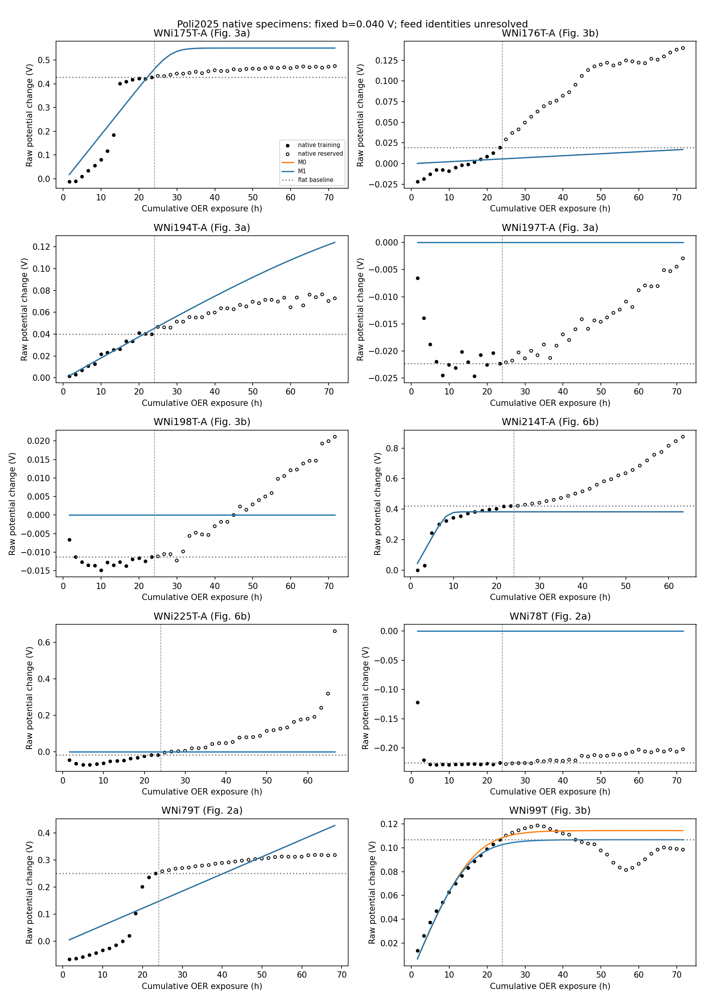

# Regeneration controls constrain maintenance, but do not identify new-material function

The481 acquired Poli2025 files provide useful electrochemical maintenance observations and a source-level Fe-supply × regeneration comparison. They do not provide a matched founder-preload/supply-withdrawal experiment or an origin-resolved functional assay. The numerical test below treats total competent activity separately from the age of the material that supplies it. No previous negative result is replaced and no integrated life component is certified.

## What was acquired and matched

[Poli et al., DOI10.1039/D5GC00114E](https://doi.org/10.1039/D5GC00114E) and its [native deposit, DOI10.34894/XW7RK6](https://doi.org/10.34894/XW7RK6), are the primary sources. This analysis uses the previously acquired subset; it is not another experimental replication. [The complete per-file inventory](file_manifest.csv) and [format/acquisition audit](INVENTORY.md) cover every acquired entry. All481 files,55,239,493bytes match both repository and acquisition checksums. They comprise462 nonempty Gamry text files, six plaintext files, four Origin projects, one XLSX and eight deposited empty files. Cycle fragments and processed copies are not independent specimens.

The source compares Fe-lean, nominal100ppb added Fe and5ppm added Fe, each with/without regeneration, at300mA/cm2. It uses separate nickel wires beginning in the corresponding feed, rather than identical preloaded wires randomized to fresh-metal supply or withdrawal. Fe-lean means an expected residual below36ppb from a purification method, not measured absence. At5ppm, visible precipitate makes total nominal addition an unsuitable dissolved-Fe rate constraint. The high-current pair uses120ppb,800mA/cm2 and half the immersed area; it is a separate stress case.

Exact raw-specimen-to-Fe assignments remain unresolved. Origin printable metadata supplies figure legends but does not independently certify every dataset/plot association; all36 cross-panel assignments remain admissible under a strict raw-level reading. No assignment is chosen by matching response shape, endpoint or model fit. Consequently the raw numerical analysis uses specimen identifiers and does not fit a dose-response law. The source's nominal-factorial observation and this raw-mapping limitation are distinct. [Source/control audit](SOURCE_AUDIT.md).

The same-wire Zn-then-Fe addition in SI FigureS19 supports Fe-specific activation on retained nickel, but its raw trace is not identified in the acquired subset or the638-entry catalogue. It is not a damaged-founder replacement experiment. SI FigureS20's high-to-low-Fe procedure describes cell cleaning between experiments. No supply-withdrawal sequence is inferred from it.

## Data limits that change the evaluator

Only native OER observations enter the primary forecast. Potentials are changes from each specimen's own early anchor, in the raw instrument reference. No unsupported RHE conversion or iR correction is applied. A constant reference/resistance offset cancels in that difference; changing resistance, morphology and bubbles remain possible explanations. Sustaining current at lower voltage is an electrode-performance observation, not an isolated new-site oxygen-production assay. No matched gas/Faradaic-efficiency measurement is identified for these arms.

WNi225T-A has nonempty OER blocks1–40. Block41 is absent from the entire catalogue;42–43 and several late pulse/impedance/CV files are empty. The processed trace nevertheless extends through43 nominal blocks. Its unsupported tail is excluded from the primary forecast and checked separately for provenance. This does not erase any late failure recorded in the available raw blocks or in the source paper.

WNi78T has an additional continuous24h record after a greater-than3h unrecorded gap and an intervening impedance measurement. Its final nominal100s regeneration file records only6s. The extension is retained separately; it cannot be silently joined into a clean pulse-withdrawal control. The Origin project also names WNi98T-A where the acquired pulse folder is WNi78T. Source labels and physical continuity remain qualified. [Pre-outcome metadata amendment](AMENDMENTS.md).

## Numerical test

The frozen [protocol](PROTOCOL.md) specifies native6000s intervals, last300s medians,0.5–1h anchor, fitting through24h OER exposure and forecasting later intervals without retuning. It fixes the competence equations, parameter grids, slope sensitivities and operational error screen before numerical response extraction. Published rounded outcomes were already known, so the test is retrospective and paper-informed. There are420interval summaries:140training and280reserved, with14additional summaries from the separate unvalidated WNi78T followup.

The conditional model conserves a normalized competent/incompetent pool: OER transfers activity out of the competent state; a pulse can restore competence. A Tafel-type parallel-current law maps total competence into voltage change. M0 pauses loss during interruption; M1 adds restoration. The model is more explicit about chemistry and function than treating survival or retained mass as repair, but its normalized pool is not a measured Fe inventory. Its observation law and fixed slope scenarios are assumptions.

The declared screen requires reserved RMSE≤50mV **and** maximum error≤100mV. Results at the primary natural-log slope b=40mV:

| Native specimen | Reserved intervals | Flat RMSE,mV | M0 RMSE,mV | M1 RMSE,mV | M1 maximum error,mV | M1 screen |
|---|---:|---:|---:|---:|---:|---|
|WNi175T-A|29|32.57|87.16|87.16|105.57|Fail|
|WNi176T-A|29|85.84|92.35|92.35|122.84|Fail|
|WNi194T-A|29|25.49|28.48|28.48|51.59|Pass|
|WNi197T-A|29|10.01|15.19|15.19|22.09|Pass|
|WNi198T-A|29|17.40|10.43|10.43|21.12|Pass|
|WNi214T-A|24|223.33|254.13|254.13|491.82|Fail|
|WNi225T-A|26|189.39|177.81|177.81|661.98|Fail|
|WNi78T|29|13.16|215.15|215.15|227.71|Fail|
|WNi79T|27|48.86|64.23|64.23|109.33|Fail|
|WNi99T|29|12.12|16.45|12.37|25.42|Pass|

Both chemical-state variants pass4/10 trace screens; the flat forecast passes7/10. The same pass counts hold for both predeclared slope sensitivities b=20and80mV. These are descriptive operational screens across different preparations, not10randomized independent replicates or statistical evidence of superiority. There is no overall predictive advantage for M1.

WNi99T gives the clearest M1-versus-M0 improvement,16.45→12.37mV RMSE, but its flat baseline is slightly better at12.12mV. Positive fitted restoration rates on several other traces occur at activity/loss grid boundaries with many nearly equivalent parameter choices; they are not measured reaction rates or evidence of replacement. M0 is nested exactly in M1; nonpulse predictions are identical by construction.

Some failures already appear during calibration. WNi78T, for example, has221.50mV training RMSE. Its later activation relative to the early anchor contradicts the model's fixed initial maximum competence. WNi175T-A and WNi79T also expose poorly represented activation/deactivation timing. Therefore their reserved failures do not isolate a missing repair mechanism. Both high-current traces fail, including a661.98mV maximum error in the pulsed WNi225T-A available raw record. No extra parameter, shifted anchor or new pool was fitted after observing these failures.

[Machine-readable results](results/analysis.json) contain all60model/slope cases, per-interval predictions/residuals, source/parameter-grid information, coverage, effective-parameter ambiguity and hashes of the frozen protocol, amendment, script and manifest. [Extraction notes](extraction_notes.md) record native current compliance, clocks and voltage semantics. Numerical execution/self-checks passed; [independent review status](checks.md) distinguishes implementation verification from failed scientific forecasts.

## Repair and founder models remain observationally equivalent

Voltage depends on summed competent activity, so transferring an unobserved contribution between founder and new-material labels leaves the prediction unchanged when their catalytic coefficients are shared. The numerical test verifies this output symmetry, then constructs a stronger closed-inventory witness using the **same initial pools**: one normalized unit of active founders and ten units of fresh metal in liquid.

In one mechanism, founders move between active and buried/dormant states and are reactivated. In the other, active metal dissolves into liquid and pulse adsorption restores the surface from a mixed old/new liquid reservoir. After12synthetic cycles, the first mechanism has0.74137active founder units and zero active new units; the second has0.08755active founder units and0.65382active new units. Both conserve each origin's finite total inventory, have identical total competent activity, and differ in predicted voltage by at most1.74×10^-17V. The new-material share in the second model is a simulated counterexample, not an estimate from Poli.

This establishes non-uniqueness within the specified observation/model class even with matched initial inventories and perfect voltage data. It neither proves that the retained-founder mechanism occurred nor rejects real material repair. The source's separate, relative composition assays do not identify the required origin-resolved functional contribution. A better voltage fit alone cannot close that gap.

## Processed/raw provenance result

The five processed files match the available native voltage sequences approximately by a×1000scale. In finite overlapping prefixes, the largest residual from an affine voltage match is about0.516mV in processed units. This numerical association is not certification of all plotted Origin transformations or an absolute RHE/iR convention. Processed time is an OER-only derived clock with small row-clock discrepancies; measured pulse durations and unassigned wall gaps remain separate.

WNi225T-A has603processed rows beyond the8040available raw rows. Twelve of those unsupported rows contain a time but no voltage. No values were filled, and none of the unsupported tail entered fitting or validation. Empty/missing native files, the derived tail and the late failure visible in native observations are retained as different evidence classes.

## What would distinguish repair from founders

The source supports a role for Fe and accessible surface state in maintaining electrode performance. Relative SIMS on separate sacrificed wires does not identify how much activity belongs to newly supplied atoms. The initial nickel host persists, and its old-metal functional capacity has no measured upper bound. Isotope incorporation by itself would still not resolve active-site contribution.

A discriminating dataset needs matched preload and damage, an origin-labelled fresh-metal supply versus controlled withdrawal, simultaneous same-specimen function and inventory, and selective new-phase activity or a valid maximum founder-activity bound. Electrolyte composition, current, pulse history, resistance and geometry must be controlled. That observation is not supplied by these files. The purpose of the numerical comparison is to test predictive maintenance and demonstrate this attribution boundary, not to relabel every recovered voltage as newly constructed function.
